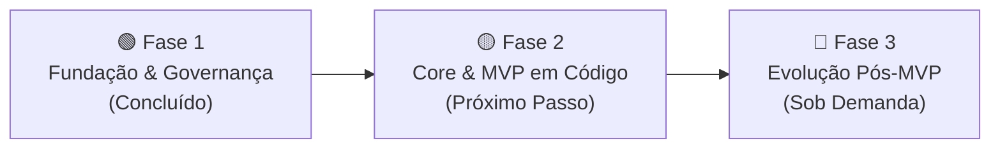

# 🗺️ Project Roadmap

Este documento define o planejamento estratégico, a ordem de execução e os critérios de aceitação para o desenvolvimento e evolução do **`institutional-website-template`**. O objetivo é manter o foco na entrega contínua, priorizando a estabilidade do MVP (Minimum Viable Product) antes de avançar para funcionalidades avançadas.

---

## 🎯 Fases de Desenvolvimento

---

### 🟢 Fase 1: Fundação Documental, Governança e Alinhamento Pré-Bootstrap (Concluído)

Esta fase estabeleceu todas as bases conceituais, registros arquiteturais formais e salvaguardas técnicas antes da escrita do código-fonte:

* [x] **Arquitetura de Alto Nível & Especificação:**
  * [x] Definição de requisitos e camadas do sistema (`docs/01-architecture-overview.md`)
  * [x] Estruturação da documentação técnica e guias de setup (`docs/02-environment-setup.md`)
  * [x] Documentação da estrutura de pastas e fronteiras (`docs/04-folder-structure.md`)
  * [x] Especificação do modelo de dados e schemas do CMS (`docs/05-keystatic-content-model.md`)
  * [x] Guia prático de estilização e temas por marca (`docs/06-brand-theming-guide.md`)
  * [x] Checklist operacional de onboarding e go-live de cliente (`docs/07-client-onboarding-checklist.md`)
  * [x] Relatório Técnico de Revisão Arquitetural da Fundação (`docs/08-architecture-review-phase1.md`)
* [x] **Registros de Decisão Arquitetural (ADRs 0001 a 0011):**
  * [x] Catálogo completo formalizado com índice geral em `docs/adr/README.md`
* [x] **Auditoria e Ajustes Pré-Bootstrap (Checklist de Governança):**
  * [x] **Pipeline de CI:** Identificação do workflow `.github/workflows/ci.yml` como provisório de fundação até a criação do `package.json`.
  * [x] **Variáveis de Ambiente:** Padronização do nome canônico `RESEND_FROM_EMAIL` em `.env.example`, CI e documentos.
  * [x] **Hospedagem do MVP:** Consolidação da Vercel como plataforma de referência oficial do MVP e isolamento do Cloudflare Pages como expansão sob demanda.
  * [x] **Exemplos e Configuração:** Sanitização de dados pessoais e URLs fictícias em `siteConfig` e comandos de clone.
  * [x] **Calibração de Declarações Técnicas e Jurídicas:** Ajuste da política de HSTS sem preload prematuro (ADR 0009), conversão de "custo zero" em "baixo custo otimizado com Matriz Financeira" (ADRs e `07-checklist`) e separação entre salvaguardas técnicas e avaliação jurídica na LGPD (ADR 0007).
  * [x] **Higiene de Repositório:** Isolamento de rascunhos locais (`docs/drafts/`) no `.gitignore`.

---

### 🟡 Fase 2: Implementação do Core & MVP (Próximo Passo / Em Planejamento)

Esta fase representa a materialização do template em código, dividida entre a execução técnica do bootstrap e a homologação do MVP.

#### 2.1. Checklist de Execução Técnica (Durante o Bootstrap):

* [ ] **Inicialização do Projeto & Dependências:**
  * [ ] Inicializar Next.js 16 (App Router - Active LTS), TypeScript e Tailwind CSS v4 com versões registradas e compatíveis com Node.js 24 LTS.
  * [ ] Instalar e configurar Shadcn/ui & primitivos Radix UI acessíveis.
  * [ ] Configurar alias de importação (`@/*`) e scripts obrigatórios no `package.json` (`lint`, `typecheck`, `test`, `build`).
* [ ] **Validação de Ambiente & Segurança:**
  * [ ] Implementar validação estrita com Zod (`src/env.ts`), com separação clara entre variáveis públicas (`client`) e segredos de servidor (`server`).
  * [ ] Atualizar `.github/workflows/ci.yml`, removendo a flag `--if-present` e transformando lint, typecheck, testes e build em quality gates bloqueantes.
  * [ ] Implementar Security Headers HTTP conservadores no `next.config.ts`.
  * [ ] Implementar política de Rate Limiting adequada ao runtime (Upstash Redis em produção serverless / Map nativo em desenvolvimento local).
* [ ] **Arquitetura de Dados & Layout Base:**
  * [ ] Implementar abstração centralizada de dados do cliente (`src/config/site.ts`).
  * [ ] Configurar variáveis de tema CSS no Tailwind (`globals.css` via `@theme`).
  * [ ] Construir layout raiz (`src/app/layout.tsx`) com metadados dinâmicos e componentes acessíveis (`Header`, `Hero`, `Footer`).
* [ ] **Formulários Transacionais & Anti-Spam:**
  * [ ] Criar schema de validação com Zod (`src/lib/validations/contact.ts`) com salvaguarda configurável de privacidade.
  * [ ] Implementar componente de formulário com React Hook Form.
  * [ ] Construir Server Action (`src/app/actions/contact.ts`) com defesa em 3 camadas (Honeypot + Cloudflare Turnstile + Resend API), isolando serviço de disparo para testes.
  * [ ] Construir páginas legais estáticas (`/politica-de-privacidade` e `/termos-de-uso`) consumindo `siteConfig`.
* [ ] **Gestão de Conteúdo (Headless CMS):**
  * [ ] Configurar Keystatic CMS (`@keystatic/next`) para modo local e Keystatic Cloud.
  * [ ] Definir schemas de coleções (Páginas, Serviços e Blog) gravando Markdown/JSON no repositório.
  * [ ] Implementar leitura de arquivos via Reader API para compilação SSG/ISR com React Server Components.
* [ ] **SEO Técnico Essencial:**
  * [ ] Metadata API com metadados dinâmicos, canonical tags e Open Graph (`src/app/layout.tsx`).
  * [ ] Sitemap dinâmico (`src/app/sitemap.ts`) e `robots.txt` (`src/app/robots.ts`).
  * [ ] Schema.org JSON-LD estruturado (`Organization` e `WebSite`).

#### 2.2. Critérios de Homologação (Antes de Considerar o MVP Concluído):

* [ ] **Resiliência de Formulários:** Testar o formulário com entradas inválidas, falhas simuladas de rede/provedor externo e tentativas abusivas de envio (anti-spam / rate limiting).
* [ ] **Usabilidade do CMS:** Validar o fluxo de edição, criação de post e publicação via Keystatic Cloud com um usuário com perfil não técnico.
* [ ] **Auditoria de Qualidade e Acessibilidade:** Executar suíte de testes unitários (`vitest-axe`), validação estática e orçamentos do Lighthouse CI em versão publicada na Vercel (LCP < 2,5 s, INP < 200 ms, CLS < 0,1, Score de Acessibilidade ≥ 95).
* [ ] **Validação Prática de Atualizações:** Testar o procedimento de propagação de atualizações em um repositório derivado real do template, avaliando conflitos de merge e patches cirúrgicos ([ADR 0010](adr/0010-estrategia-de-atualizacao-e-versionamento.md)).
* [ ] **Homologação Ponta a Ponta:** Executar o checklist de onboarding completo ([docs/07-client-onboarding-checklist.md](07-client-onboarding-checklist.md)) em um projeto piloto de teste, do setup inicial ao deploy com domínio e DNS.

---

### 🔵 Fase 3: Evolução e Recursos Avançados (Pós-MVP / Sob Demanda)

Funcionalidades opcionais que podem ser ativadas em projetos específicos de clientes, conforme a necessidade do negócio:

* [ ] Suporte a múltiplos idiomas (Internacionalização / i18n com tags `hreflang`)
* [ ] Implementação de Dark Mode nativo com troca de variáveis no Tailwind
* [ ] Área logada / Autenticação de usuários (se exigido pelo projeto do cliente)
* [ ] Adaptador oficial para deploy alternativo no Cloudflare Pages via OpenNext (`@cloudflare/next-on-pages`)
* [ ] SEO avançado: Schemas JSON-LD especializados (`LocalBusiness` multi-endereço, `Product`, `Event`), índices de sitemap (`sitemap-index.xml`)
* [ ] Integração com ferramentas de análise de tráfego avançadas (Plausible / Google Analytics 4 com Cookie Banner)
* [ ] Módulos de comércio eletrônico ou checkout integrado (Stripe / Mercado Pago)

---

## 📌 Critérios de Sucesso Mensuráveis do MVP

O template será considerado pronto para homologação e uso em produção comercial quando atingir rigorosamente as seguintes metas:

### 1. Métricas de Performance e Core Web Vitals (Medição Mobile / Emulated 4G)

* **LCP (Largest Contentful Paint):** `< 2,5 s`
* **INP (Interaction to Next Paint):** `< 200 ms`
* **CLS (Cumulative Layout Shift):** `< 0,1`
* **FCP (First Contentful Paint):** `< 1,8 s`
* **TTFB (Time to First Byte):** `< 800 ms`

### 2. Google Lighthouse Scores (Mobile)

* **Performance:** `≥ 90`
* **Acessibilidade:** `≥ 95` (e **0 violações críticas ou sérias** no axe-core)
* **Melhores Práticas:** `≥ 95`
* **SEO:** `100`

### 3. Eficiência Operacional & Custo de Infraestrutura

* **Onboarding de Cliente:** Novo site institucional colocado no ar em menos de **2 horas** modificando exclusivamente `src/config/site.ts`, variáveis de `@theme` no `globals.css` e assets de `/public`.
* **Previsibilidade e Baixo Custo:** Operação estruturada para iniciar em tiers gratuitos ou de baixo custo no tráfego institucional padrão (Vercel, Resend, Upstash, Keystatic Cloud), com matriz de governança de limites e titularidade financeira clara.
* **Comunicação Transacional Confiável:** Formulário de contato enviando e-mails via Resend com SPF, DKIM e DMARC validados (Score no [Mail-Tester](https://www.mail-tester.com/) `≥ 9/10`).
