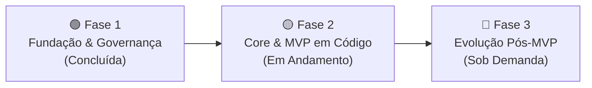

# 🗺️ Project Roadmap

Este documento define o planejamento estratégico, a ordem de execução e os critérios de aceitação para o desenvolvimento e evolução do **`institutional-website-template`**. O objetivo é manter o foco na entrega contínua, priorizando a estabilidade do MVP (Minimum Viable Product) antes de avançar para funcionalidades avançadas.

---

## 🎯 Fases de Desenvolvimento

---

### 🟢 Fase 1: Fundação Documental, Governança e Alinhamento Pré-Bootstrap (Concluída)

Esta fase estabeleceu todas as bases conceituais, registros arquiteturais formais e salvaguardas técnicas antes da escrita do código-fonte:

- [x] **Arquitetura de Alto Nível & Especificação:**
  - [x] Definição de requisitos e camadas do sistema (`docs/01-architecture-overview.md`)
  - [x] Estruturação da documentação técnica e guias de setup (`docs/02-environment-setup.md`)
  - [x] Documentação da estrutura de pastas e fronteiras (`docs/04-folder-structure.md`)
  - [x] Especificação do modelo de dados e schemas do CMS (`docs/05-keystatic-content-model.md`)
  - [x] Guia prático de estilização e temas por marca (`docs/06-brand-theming-guide.md`)
  - [x] Checklist operacional de onboarding e go-live de cliente (`docs/07-client-onboarding-checklist.md`)
  - [x] Relatório Técnico de Revisão Arquitetural da Fundação (`docs/08-architecture-review-phase1.md`)
- [x] **Registros de Decisão Arquitetural (ADRs 0001 a 0011):**
  - [x] Catálogo completo formalizado com índice geral em `docs/adr/README.md`
- [x] **Auditoria e Ajustes Pré-Bootstrap (Checklist de Governança):**
  - [x] **Pipeline de CI:** Identificação do workflow `.github/workflows/ci.yml` como provisório de fundação até a criação do `package.json`.
  - [x] **Variáveis de Ambiente:** Padronização do nome canônico `RESEND_FROM_EMAIL` em `.env.example`, CI e documentos.
  - [x] **Hospedagem do MVP:** Consolidação da Vercel como plataforma de referência oficial do MVP e isolamento do Cloudflare Pages como expansão sob demanda.
  - [x] **Exemplos e Configuração:** Sanitização de dados pessoais e URLs fictícias em `siteConfig` e comandos de clone.
  - [x] **Calibração de Declarações Técnicas e Jurídicas:** Ajuste da política de HSTS sem preload prematuro (ADR 0009), conversão de "custo zero" em "baixo custo otimizado com Matriz Financeira" (ADRs e `07-checklist`) e separação entre salvaguardas técnicas e avaliação jurídica na LGPD (ADR 0007).
  - [x] **Higiene de Repositório:** Isolamento de rascunhos locais (`docs/drafts/`) no `.gitignore`.

---

### 🟡 Fase 2: Implementação do Core & MVP (Em Andamento — Features 001, 002 e 003 Concluídas)

Esta fase representa a materialização do template em código, dividida entre a execução técnica do bootstrap e a homologação do MVP.

#### 2.1. Checklist de Execução Técnica

- [x] **Inicialização do Projeto & Dependências (Feature 001 Concluída):**
  - [x] Inicializar Next.js 16 (App Router - Active LTS), TypeScript e Tailwind CSS v4 com versões registradas e compatíveis com Node.js 24 LTS.
  - [x] Configurar alias de importação (`@/*`) e scripts obrigatórios no `package.json` (`lint`, `typecheck`, `test`, `build`).
  - [x] Promover `.github/workflows/ci.yml` de provisório para definitivo no primeiro commit funcional, removendo a checagem condicional de bootstrap (`check-bootstrap`) para que a esteira execute todos os quality gates (`npm ci`, `lint`, `typecheck`, `test`, `build`) de forma 100% incondicional e bloqueante.
  - [x] Implementar Security Headers HTTP conservadores no `next.config.ts`.
  - [x] Configurar variáveis de tema CSS no Tailwind (`globals.css` via `@theme`).
  - [x] Instalar e configurar Shadcn/ui & primitivos Radix UI acessíveis (Feature 002 Concluída).
- [x] **Arquitetura de Dados & Layout Base (Feature 002 Concluída):**
  - [x] Implementar abstração centralizada de dados do cliente (`src/config/site.ts` - Feature 002 Concluída).
  - [x] Configurar variáveis de tema CSS no Tailwind (`globals.css` via `@theme` - Feature 001/002 Concluída).
  - [x] Construir layout raiz (`src/app/layout.tsx`) com metadados dinâmicos e componentes acessíveis (`Header`, `Hero`, `Footer` - Feature 002 Concluída).
- [x] **Formulários Transacionais & Anti-Spam (Feature 003 Concluída):**
  - [x] Validação segregada de variáveis de ambiente (`src/env/server.ts` e `src/env/client.ts`).
  - [x] Criar schema de validação com Zod (`src/lib/schemas/contact.ts`) com salvaguarda configurável de privacidade e opt-in explícito (LGPD Art. 5º, XII).
  - [x] Implementar política de Rate Limiting anônimo por hash de IP via script Lua atômico (Upstash Redis em produção / Map nativo em desenvolvimento e testes com Fail-Closed).
  - [x] Implementar componente de formulário acessível com React Hook Form (`src/components/shared/contact-form/contact-form.tsx`).
  - [x] Construir Server Action (`src/app/actions/contact.ts`) com defesa em 3 camadas (Honeypot + Rate Limit + Cloudflare Turnstile + Resend API), proteção de tamanho de payload (`bodySizeLimit = "64kb"`) e mascaramento de erros.
  - [x] Implementar botão flutuante de WhatsApp global acessível (`src/components/shared/floating-whatsapp/`) com alvo de 56px e WCAG 2.1 AA.
  - [x] Construir páginas legais estáticas (`/politica-de-privacidade` e `/termos-de-uso`) consumindo `siteConfig`, com cláusula de transferência internacional (Art. 33) e declaração condicional de serviços ativos.
- [ ] **Gestão de Conteúdo (Headless CMS - Feature 004 Próxima):**
  - [ ] Executar spike técnico prévio de compatibilidade do Keystatic com Next.js 16 e React 19 (validando rotas de API, Admin UI e GitHub mode antes do desenvolvimento de coleções).
  - [ ] Configurar Keystatic CMS (`@keystatic/next`) para modo local e Keystatic Cloud.
  - [ ] Definir schemas de coleções (Páginas, Serviços e Blog) gravando Markdown/JSON no repositório.
  - [ ] Padronizar seeding de conteúdo inicial (_seed data_) com arquivos Markdown/JSON pré-populados de exemplo (Home, Sobre, 2 serviços, 3 FAQs e 2 posts) para que o repositório já nasça 100% preenchido e funcional ao ser clonado.
  - [ ] Implementar leitura de arquivos via Reader API para compilação SSG/ISR com React Server Components.
- [ ] **SEO Técnico Essencial:**
  - [ ] Metadata API com metadados dinâmicos, canonical tags e Open Graph (`src/app/layout.tsx`).
  - [ ] Sitemap dinâmico (`src/app/sitemap.ts`) e `robots.txt` (`src/app/robots.ts`).
  - [ ] Schema.org JSON-LD estruturado (`Organization` e `WebSite`).

#### 2.2. Critérios Objetivos de Homologação (Antes de Considerar o MVP Concluído)

- [ ] **1. Validação de Ambientes e Segregação de Envs (`src/env/`):**
  - [ ] Testar build com configuração mínima de desenvolvimento/CI no Modo Lite (`NEXT_PUBLIC_SITE_URL`, `RESEND_API_KEY`, `RESEND_FROM_EMAIL`, `CONTACT_EMAIL_TO`, `RATE_LIMIT_SECRET` e `NEXT_PUBLIC_ENABLE_TURNSTILE="false"`).
  - [ ] Testar build com configuração completa de produção (todas as integrações ativas no Modo Robusto).
  - [ ] Testar rejeição imediata com mensagens claras de erro diante de variáveis ausentes ou inválidas (incluindo aborto de build se o Turnstile estiver ativo em produção com chaves ausentes ou Upstash configurado pela metade).
  - [ ] Assegurar que integrações opcionais desativadas (ex.: Turnstile ou Upstash no Modo Lite) não quebrem o build nem deixem o formulário em estado vulnerável.
- [ ] **2. Compatibilidade Prática de Dependências & Lockfile:**
  - [x] Gerar e versionar o `package-lock.json` com instalação determinística via `npm ci` (Feature 001 Concluída).
  - [ ] Validar compatibilidade efetiva em tempo de compilação e execução entre Next.js 16, React 19, Tailwind CSS v4, Keystatic e Radix UI sob Node.js 24 LTS, sem conflitos de dependências não resolvidos.
- [ ] **3. Bateria de Testes Automatizados do Formulário (Server Action) & Deploy Piloto:**
  - [ ] Testar descarte imediato diante de payload inválido, malformado ou não-objeto.
  - [ ] Testar validação estrita de tamanho: rejeição de mensagens acima de 1.000 caracteres no schema funcional e bloqueio prévio de payloads abusivos acima de 5.000 caracteres (~5 KB).
  - [ ] Testar rejeição com erro amigável quando token Turnstile for ausente, forjado ou inválido (e desativação graciosa no modo Lite).
  - [ ] Testar contenção por Rate Limiting quando o IP ultrapassar 5 envios/hora.
  - [ ] Testar contingência diante de falha da API da Resend (HTTP 429 ou cota esgotada), assegurando exibição dos contatos diretos do `siteConfig` sem expor detalhes internos.
  - [ ] Testar política Fail-Closed diante de indisponibilidade ou timeout do Upstash Redis em produção (bloqueio preventivo do envio com mensagem amigável orientando canais diretos para preservar a cota do Resend).
  - [ ] Executar deploy piloto de sanidade na Vercel (_smoke test_) ao término da Feature 003, homologando antecipadamente Server Actions, runtime serverless e Resend API em nuvem real.
- [ ] **4. Autonomia Real de Conteúdo e CMS (Requisito de Produto):**
  - [ ] Validar o fluxo de ponta a ponta com um usuário de perfil não técnico no Keystatic Cloud: criação de post, edição de texto institucional e adição de imagem.
  - [ ] Confirmar que o commit gerado pelo CMS disparou com sucesso o build automático de SSG no GitHub Actions / Vercel.
- [ ] **5. Acessibilidade e Performance com Evidências Registradas:**
  - [ ] Executar suíte automatizada com `vitest-axe` em todos os componentes de interface (zero violações críticas ou sérias de WCAG 2.1 AA).
  - [ ] Executar auditoria do Lighthouse CI em páginas representativas, registrando condições de teste (emulação móvel e conexão 4G) e validando metas de LCP < 2,5 s, INP < 200 ms, CLS < 0,1 e Score ≥ 90/95.
- [ ] **6. Governança de Privacidade e Fidelidade das Páginas Legais:**
  - [ ] Inspecionar `/politica-de-privacidade` e `/termos-de-uso` para garantir que discriminam exatamente as integrações ativadas para o cliente (sem assumir conformidade automática sem revisão do DPO).
- [ ] **7. Validação Prática de Atualizações do Template & Automação de Patches:**
  - [ ] Testar procedimento de propagação de atualizações em repositório derivado real, avaliando conflitos e validando aplicação cirúrgica de patches ([ADR 0010](adr/0010-estrategia-de-atualizacao-e-versionamento.md)).
  - [ ] Projetar utilitário/script CLI de sincronização (`scripts/sync-template.mjs`) para aplicar patches de segurança e melhorias nas zonas de engenharia de múltiplos repositórios clientes sem sobrepor customizações de marca (`src/config/site.ts`, `globals.css` e `/public/`).
- [ ] **8. Homologação Piloto Ponta a Ponta:**
  - [ ] Executar o checklist de onboarding completo ([docs/07-client-onboarding-checklist.md](07-client-onboarding-checklist.md)) em um projeto piloto de teste, do setup inicial ao deploy com domínio e DNS.

---

### 🔵 Fase 3: Evolução e Recursos Avançados (Pós-MVP / Sob Demanda)

Funcionalidades opcionais que podem ser ativadas em projetos específicos de clientes, conforme a necessidade do negócio:

- [ ] Suporte a múltiplos idiomas (Internacionalização / i18n com tags `hreflang`)
- [ ] Implementação de Dark Mode dinâmico com alternador de tema interativo (`ModeToggle`), detecção de preferências e persistência de estado (a infraestrutura base de tokens CSS já reside no `src/app/globals.css`)
- [ ] Área logada / Autenticação de usuários (se exigido pelo projeto do cliente)
- [ ] Adaptador oficial para deploy alternativo no Cloudflare Pages via OpenNext (`@cloudflare/next-on-pages`)
- [ ] SEO avançado: Schemas JSON-LD especializados (`LocalBusiness` multi-endereço, `Product`, `Event`), índices de sitemap (`sitemap-index.xml`)
- [ ] Integração com ferramentas de análise de tráfego avançadas (Plausible / Google Analytics 4 com Cookie Banner)
- [ ] Módulos de comércio eletrônico ou checkout integrado (Stripe / Mercado Pago)

---

## 📌 Critérios de Sucesso Mensuráveis do MVP (Metas Planejadas)

As seguintes métricas foram estabelecidas como metas de referência para o MVP, devendo ser formalmente medidas e comprovadas em ambiente de teste/piloto antes do lançamento comercial:

### 1. Métricas de Performance e Core Web Vitals (Medição Mobile / Emulated 4G)

- **LCP (Largest Contentful Paint):** `< 2,5 s`
- **INP (Interaction to Next Paint):** `< 200 ms`
- **CLS (Cumulative Layout Shift):** `< 0,1`
- **FCP (First Contentful Paint):** `< 1,8 s`
- **TTFB (Time to First Byte):** `< 800 ms`

### 2. Google Lighthouse Scores (Mobile)

- **Performance:** `≥ 90`
- **Acessibilidade:** `≥ 95` (e **0 violações críticas ou sérias** no axe-core)
- **Melhores Práticas:** `≥ 95`
- **SEO:** `100`

### 3. Eficiência Operacional & Custo de Infraestrutura

- **Onboarding de Cliente (Meta Planejada):** Tempo de onboarding projetado em menos de **2 horas** modificando exclusivamente `src/config/site.ts`, variáveis de `@theme` no `globals.css` e assets de `/public`, a ser aferido em projeto piloto real.
- **Previsibilidade e Baixo Custo:** Validação prática de operação dentro dos limites de planos gratuitos/baixo custo no tráfego institucional típico (Vercel, Resend, Upstash, Keystatic Cloud), com governança e gatilhos de upgrade confirmados.
- **Comunicação Transacional Confiável:** Formulário de contato enviando e-mails via Resend com SPF, DKIM e DMARC validados (Score no [Mail-Tester](https://www.mail-tester.com/) `≥ 9/10`).
