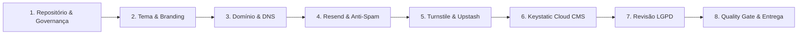

# 📋 Checklist Operacional de Onboarding de Cliente

Este documento é o guia definitivo passo a passo para colocar no ar o site institucional de um novo cliente a partir deste template. O processo é estruturado com a meta projetada de ser concluído em **menos de 2 horas** (a ser aferida e calibrada formalmente na homologação do primeiro projeto piloto), garantindo alta segurança, conformidade legal (LGPD), excelente entregabilidade de e-mails (SPF, DKIM, DMARC) e infraestrutura de baixo custo com governança clara de limites e titularidade financeira.

---

## 🧭 Visão Geral do Fluxo



---

## 💰 Matriz de Custos, Limites Gratuitos e Responsabilidade Financeira

Para assegurar uma relação transparente e sem surpresas entre a agência/desenvolvedor e o cliente final, a tabela abaixo mapeia cada serviço utilizado pelo template, seus limites no plano gratuito, gatilhos de upgrade e a respectiva responsabilidade de pagamento:

| Recurso / Serviço | Plano Base Inicial | Limite Gratuito Incluído | Gatilho para Plano Pago | Responsável Financeiro | Aferido em |
| :--- | :--- | :--- | :--- | :--- | :---: |
| **Registro de Domínio**<br/>*(Registro.br / GoDaddy)* | Pago pelo cliente | Não possui plano gratuito | Cobrança anual (aprox. R$ 40/ano para `.com.br` ou ~US$ 14/ano para `.com`) | **Cliente** (titularidade e dados cadastrais próprios) | Out/2026 |
| **Hospedagem & CDN (Vercel)** | Hobby (Pessoal) ou Pro (Comercial) | Hobby: 100 GB banda, builds ilimitados para projetos não comerciais | Uso comercial estrito exige Vercel Pro (US$ 20/mês por assento) | **Cliente** (conta mantida no nome da empresa do cliente) | Out/2026 |
| **Hospedagem & CDN (Cloudflare Pages)**<br/>*(Alternativa Arquitetural)* | Free (Alternativa Comercial) | Ilimitado de requisições e banda, 500 builds/mês, uso comercial permitido | Necessidade de recursos corporativos avançados ou mais de 500 builds/mês | **Cliente** | Out/2026 |
| **E-mails Transacionais (Resend)** | Gratuito | 3.000 e-mails/mês com teto estrito de **100 e-mails/dia** | Ultrapassar 100 envios/dia exige plano Pro (a partir de US$ 20/mês) | **Cliente** | Out/2026 |
| **Proteção Anti-Spam (Cloudflare Turnstile)** | Gratuito | Ilimitado para a esmagadora maioria de sites institucionais | Planos enterprise com SLA dedicado | **Cliente** | Out/2026 |
| **Rate Limiting em Produção (Upstash Redis)** | Serverless Free | Até **10.000 comandos/dia**, 256 MB de dados e até 100 conexões simultâneas | Ultrapassar 10.000 comandos/dia (Pay-as-you-go ~US$ 0,20 por 100k comandos) | **Cliente** | Out/2026 |
| **Gestão de Conteúdo (Keystatic Cloud)** | Gratuito | Até **3 editores** por projeto com commits automáticos | Necessidade de mais de 3 editores simultâneos | **Cliente** | Out/2026 |
| **Armazenamento de Mídia** | Repositório Git (Gratuito) | Até **1 GB** recomendado no GitHub sem lentidão de clone | Bibliotecas volumosas de fotos em alta resolução ou vídeos requerem CDN externa (Cloudinary / Vercel Blob) | **Cliente** | Out/2026 |

> 💡 **Nota sobre Limites e Tarifas:** Os limites de planos gratuitos e políticas comerciais de serviços SaaS (Vercel, Resend, Upstash, Cloudflare) estão sujeitos a alterações periódicas por seus fornecedores. Consulte as tabelas oficiais de preços vigentes ao iniciar cada novo projeto de cliente.

> ℹ️ **Nota sobre Cloudflare Pages:** Embora o plano gratuito da Cloudflare permita uso comercial, rodar Next.js com App Router, Server Actions e Keystatic na Cloudflare exige adaptação de runtime (`@cloudflare/next-on-pages` ou OpenNext), limites de Edge isolates e loader específico para imagens. Para o MVP, a **Vercel é a plataforma de referência oficial**, e a implantação na Cloudflare é mantida como alternativa arquitetural a ser conduzida via guia técnico dedicado.

> ⚠️ **Regra de Ouro da Governança (Titularidade do Cliente):**  
> O desenvolvedor ou agência **nunca deve utilizar cartões de crédito pessoais** para cadastrar ou manter serviços de clientes. Todas as contas de produção (Vercel, Cloudflare, Resend, Upstash, Registro de Domínio) devem ser criadas ou transferidas diretamente para a titularidade da empresa contratante.

---

## 🛠️ Etapa 1: Repositório & Governança

- [ ] **1.1. Criar repositório do cliente:**
  - No GitHub, clique em **Use this template** > **Create a new repository**.
  - Nome sugerido: `site-[nome-do-cliente]` (ex: `site-clinica-alvorada`).
  - Visibilidade: **Private** (garante privacidade dos dados cadastrais do cliente).
- [ ] **1.2. Clonar localmente:**

  ```bash
  git clone https://github.com/sua-organizacao/site-cliente.git
  cd site-cliente
  npm install
  ```

- [ ] **1.3. Vincular o Template Original como Upstream:**
  - Permite puxar atualizações futuras e patches de segurança conforme definido no [ADR 0010](adr/0010-estrategia-de-atualizacao-e-versionamento.md):

  ```bash
  git remote add template https://github.com/heviane/institutional-website-template.git
  git fetch template
  ```

- [ ] **1.4. Desvincular Governança do Template (Ownership & Titularidade):**
  - [ ] **Atualizar `.github/CODEOWNERS`:** Substituir `@heviane` pelo time técnico ou responsáveis no GitHub da organização do cliente (ou excluir o arquivo caso o cliente não utilize revisão obrigatória por codeowners).
  - [ ] **Customizar `SECURITY.md`:**
    - Substituir `heviane@gmail.com` pelo e-mail do DPO ou da equipe técnica do cliente (ex.: `dpo@cliente.com.br` ou `seguranca@cliente.com.br`).
    - Atualizar a URL do Security Advisory Privado para o repositório do cliente (`https://github.com/[org-cliente]/[repo-cliente]/security/advisories/new`) ou remover a seção caso o repositório não tenha Private Vulnerability Reporting ativado.
  - [ ] **Ajustar `LICENSE`:** Adaptar a licença de acordo com o contrato comercial firmado com o cliente (substituir o copyright para `Copyright (c) 2026 [Razão Social do Cliente]` ou declarar licença proprietária/fechada).
  - [ ] **Ajustar `.github/ISSUE_TEMPLATE/config.yml`:** Atualizar os links de contato ou remover apontamentos que redirecionem para o repositório upstream do template (`discussions` e `security advisories`).
  - [ ] **Ajustar `CONTRIBUTING.md` e `README.md`:** Substituir a documentação do template por um README simples focado no cliente (links de homologação/produção, contatos dos desenvolvedores e comandos básicos).
- [ ] **1.5. Proteger a Branch `main`:**
  - Em `Settings` > `Branches` no GitHub, crie uma regra de proteção exigindo que o pipeline de CI (`ci.yml`) passe antes de merges.

---

## 🎨 Etapa 2: Identidade Visual & Conteúdo Base (10 minutos)

- [ ] **2.1. Configurar Dados Globais em `src/config/site.ts`:**
  - [ ] Razão Social e Nome Fantasia
  - [ ] CNPJ e Inscrição Estadual (se aplicável)
  - [ ] E-mail de atendimento (`contato@cliente.com.br`)
  - [ ] Telefone comercial e WhatsApp (com código DDI e DDD)
  - [ ] Endereço completo com CEP
  - [ ] Links de redes sociais (LinkedIn, Instagram, Facebook, etc.)
- [ ] **2.2. Configurar Cores da Marca em `src/app/globals.css`:**
  - Extrair a paleta primária da marca do cliente e substituir as variáveis em `@theme`:
    - `--primary` e `--primary-foreground`
    - `--secondary` e `--secondary-foreground`
    - `--accent` e `--accent-foreground`
- [ ] **2.3. Substituir Assets Estáticos em `/public`:**
  - [ ] `public/images/brand/logo.svg` e `logo-dark.svg` (Logotipos vetorizados para fundos claro e escuro)
  - [ ] `public/favicon.ico` e `favicon.svg` (Ícone de aba)
  - [ ] `public/apple-touch-icon.png` (180x180 px para dispositivos iOS)
  - [ ] `public/og.jpg` (1200x630 px com título, logo e slogan para redes sociais)
- [ ] **2.4. Definir Tipografia em `src/app/layout.tsx`:**
  - Ajustar a importação de `next/font/google` com as famílias tipográficas do cliente.

---

## 🌐 Etapa 3: Domínio, DNS & Hospedagem (Vercel)

> 💡 **Plataforma de Referência do MVP:** A Vercel é o ambiente de hospedagem padrão oficial para o MVP deste template, com suporte nativo total a Next.js 16 (App Router, Server Actions, SSG e `next/image`). Caso o cliente demande no futuro implantação na Cloudflare Pages via OpenNext, consulte o [ADR 0005](adr/0005-estrategia-de-hospedagem-e-cicd.md).

- [ ] **3.1. Conectar Repositório na Vercel:**
  - Acessar o painel da [Vercel](https://vercel.com/) com a conta da empresa do cliente (obedecendo à regra de titularidade).
  - Clicar em **Add New...** > **Project** e importar o repositório privado `site-[nome-do-cliente]`.
  - Framework Preset: **Next.js** (automático).
  - Clicar em **Deploy** para gerar a URL de preview inicial.
- [ ] **3.2. Configurar Domínio Personalizado na Vercel:**
  - No projeto na Vercel, acessar **Settings** > **Domains**.
  - Adicionar o domínio raiz (`cliente.com.br`) e o subdomínio canônico (`www.cliente.com.br`).
  - Configurar o redirecionamento automático (ex.: redirecionar `cliente.com.br` para `www.cliente.com.br`).
- [ ] **3.3. Configurar Apontamentos DNS (no Registro.br, Cloudflare DNS ou GoDaddy):**
  - ⚠️ **Importante:** Copie **SEMPRE** os valores exatos exibidos na aba **Settings** > **Domains** do seu projeto na Vercel, pois a plataforma pode fornecer endereços Anycast dedicados ou CNAMEs específicos. Os valores padrão de referência são:

  | Tipo | Nome / Host | Valor / Destino (Padrão de Referência) | TTL |
  | :--- | :--- | :--- | :--- |
  | **A** | `@` (raiz) | `76.76.21.21` *(ou IP específico gerado no painel)* | 3600 (1h) |
  | **CNAME** | `www` | `cname.vercel-dns.com.` *(ou CNAME específico do projeto)* | 3600 (1h) |

- [ ] **3.4. Validar Emissão de Certificado SSL/TLS:**
  - Aguardar a propagação do DNS e verificar se o status do domínio na Vercel exibe **Valid Configuration** e o cadeado HTTPS está ativo no navegador.

---

## 📧 Etapa 4: Configuração de E-mails Transacionais (Resend & DNS Anti-Spam)

Conforme [ADR 0003](adr/0003-estrategia-de-formularios.md), formulários institucionais exigem autenticação rigorosa para evitar a caixa de spam do destinatário.

- [ ] **4.1. Criar Domínio no Resend:**
  - No painel do [Resend](https://resend.com/), vá em **Domains** > **Add Domain**.
  - Recomendado: cadastrar o domínio principal `cliente.com.br` (o Resend gerará automaticamente o subdomínio técnico de envio) ou subdomínio dedicado `notificacoes.cliente.com.br`.
- [ ] **4.2. Inserir os Registros DNS Exatos Fornecidos pelo Resend:**
  - ⚠️ **Regra de Ouro:** Copie **SEMPRE os valores exatos gerados pelo painel do Resend**. Não insira registros SPF genéricos na raiz por conta própria, pois o Resend opera via subdomínio dedicado de envio (ex.: `send.cliente.com.br` ou `bounces.cliente.com.br`) para **não conflitar** com os registros MX corporativos do cliente (como Google Workspace ou Microsoft 365).
  - [ ] **DKIM (Assinatura Criptográfica):** Registro `TXT` ou `CNAME` gerado pelo Resend (ex.: `resend._domainkey`).
  - [ ] **SPF / Return-Path:** Registro `MX` e `TXT` no subdomínio de envio informado pelo Resend (ex.: `bounces.cliente.com.br`).
  - [ ] **DMARC (Política de Alinhamento):** Adicionar registro `TXT` no host `_dmarc.cliente.com.br`:

    ```text
    v=DMARC1; p=none; rua=mailto:dmarc@cliente.com.br
    ```

- [ ] **4.3. Verificar Domínio no Resend:**
  - Clicar em **Verify DNS Records** no painel do Resend até todos os itens exibirem status verde (`Verified`).
- [ ] **4.4. Gerar Chave de API:**
  - Em **API Keys**, criar uma nova chave com permissão de envio (`Sending access`).
  - Copiar o valor `re_xxxxxxxxxxxx`.
- [ ] **4.5. Teste de Entregabilidade:**
  - Enviar um e-mail de teste para o [Mail-Tester](https://www.mail-tester.com/) e garantir nota mínima de **9/10**.
- [ ] **4.6. Configurar Alertas de Cota e Canais de Contingência:**
  - No painel do Resend, acessar **Settings** > **Alerts** e configurar notificações por e-mail quando o consumo diário atingir 80% e 100% (conforme [ADR 0011](adr/0011-defesa-antispam-e-protecao-de-formularios.md)).
  - Confirmar que canais alternativos diretos (WhatsApp comercial e e-mail direto) estão cadastrados em `src/config/site.ts` para servir de fallback ao visitante caso a cota do formulário seja atingida.

---

## 🛡️ Etapa 5: Proteção Anti-Abuso e Rate Limiting (Cloudflare Turnstile & Upstash Redis)

- [ ] **5.1. Criar Widget no Cloudflare Dashboard:**
  - Acesse **Turnstile** no painel do Cloudflare (plano gratuito).
  - Nome do widget: `Formulário de Contato - [Cliente]`.
  - Tipo de widget: **Managed** (invisível na maioria das vezes, sem quebra-cabeças visuais).
  - Domínios permitidos:
    - `localhost`
    - `cliente.com.br`
    - `www.cliente.com.br`
    - `*.vercel.app`
- [ ] **5.2. Obter Chaves do Turnstile:**
  - Copiar **Site Key** (`0x4AAAAAA...`)
  - Copiar **Secret Key** (`0x4AAAAAA...`)
- [ ] **5.3. Criar Banco Serverless no Upstash Redis (Rate Limiting de Produção):**
  - Conforme [ADR 0011](adr/0011-defesa-antispam-e-protecao-de-formularios.md), acesse [console.upstash.com](https://console.upstash.com/) (sob titularidade da empresa contratante).
  - Crie uma base de dados Redis Serverless no plano gratuito (região `sa-east-1` ou `us-east-1`).
  - Em **Details** > **REST API**, copiar:
    - `UPSTASH_REDIS_REST_URL` (`https://xxxx.upstash.io`)
    - `UPSTASH_REDIS_REST_TOKEN` (`Axxx...`)

---

## 📝 Etapa 6: Keystatic Cloud CMS em Produção

Conforme [ADR 0006](adr/0006-autenticacao-cms-e-gestao-de-midia.md), utilizamos o Keystatic Cloud para autenticação segura sem exigir conta de desenvolvedor no GitHub para o cliente.

- [ ] **6.1. Cadastrar Projeto no Keystatic Cloud:**
  - Acesse [keystatic.cloud](https://keystatic.cloud) e conecte com a conta GitHub da agência.
  - Crie um novo projeto apontando para o repositório privado do cliente (`site-cliente`).
  - Copiar o slug do projeto (ex: `agencia/site-cliente`).
- [ ] **6.2. Convidar o Usuário do Cliente:**
  - No painel do Keystatic Cloud, convidar o e-mail do cliente como **Editor**.
  - O cliente receberá um link seguro de acesso sem precisar entender Git.
- [ ] **6.3. Configurar Variáveis de Ambiente na Vercel:**
  - No painel da Vercel, em **Settings** > **Environment Variables**, adicionar para os ambientes *Production* e *Preview*:

    ```env
    NEXT_PUBLIC_SITE_URL=https://www.cliente.com.br
    RESEND_API_KEY=re_xxxxxxxxxxxxxxxxxxxx
    RESEND_FROM_EMAIL="Contato Cliente <contato@cliente.com.br>"
    CONTACT_EMAIL_TO=comercial@cliente.com.br
    NEXT_PUBLIC_TURNSTILE_SITE_KEY=0x4AAAAAAxxxxxxxx
    TURNSTILE_SECRET_KEY=0x4AAAAAAxxxxxxxx
    UPSTASH_REDIS_REST_URL=https://xxxx.upstash.io
    UPSTASH_REDIS_REST_TOKEN=Axxxxxxxxxxxxxxxxxxxx
    NEXT_PUBLIC_KEYSTATIC_PROJECT=agencia/site-cliente
    ```

- [ ] **6.4. Validar o CMS em Produção:**
  - Acessar `https://www.cliente.com.br/keystatic`.
  - Fazer login com o e-mail convidado.
  - Criar um post ou alterar um texto institucional.
  - Verificar se o commit foi gerado automaticamente no repositório GitHub e disparou novo build de SSG.

---

## ⚖️ Etapa 7: Revisão de Privacidade e Conformidade LGPD

Conforme [ADR 0007](adr/0007-conformidade-lgpd-e-privacidade.md):

- [ ] **7.1. Identificar o Encarregado de Dados (DPO) ou Canal de Atendimento:**
  - Obter o nome e e-mail de contato para privacidade da empresa do cliente (ex: `privacidade@cliente.com.br`).
- [ ] **7.2. Customizar as Páginas Legais com os Serviços Efetivamente Ativos:**
  - Atualizar os dados cadastrais da empresa em `src/config/site.ts`.
  - Revisar `src/app/(legal)/politica-de-privacidade/page.tsx` para garantir correspondência exata com as ferramentas ativadas para o cliente:
    - Se Cloudflare Turnstile estiver ativo: descrever a verificação técnica de ambiente e prevenção anti-abuso.
    - Se Plausible estiver ativo: detalhar a telemetria agregada sem cookies e com hash rotativo diário.
    - Se Google Analytics 4 / Pixels estiverem ativos: ativar o Cookie Banner e listar os cookies de terceiros.
    - Descrever o fluxo de mensagens de contato via Resend (retenção efêmera e entrega à caixa postal corporativa).
  - Revisar `src/app/(legal)/termos-de-uso/page.tsx`.
- [ ] **7.3. Alinhar Base Legal e Validação do Formulário:**
  - Confirmar com o cliente se o formulário utiliza a base de *Procedimentos Preliminares Contratuais (Art. 7º, V)* com aviso informativo transparente ou se requer *Consentimento Expresso (Art. 7º, I)* com checkbox ativo no schema do Zod (ex.: para inclusão em newsletter/marketing).
  - Caso utilize checkbox de consentimento, validar o teste com campo desmarcado (erro no Zod) e marcado (sucesso).

---

## 🚀 Etapa 8: Quality Gate Final & Entrega ao Cliente

- [ ] **8.1. Verificação Automatizada Local:**

  ```bash
  npm run lint
  npm run typecheck
  npm run test
  npm run build
  ```

- [ ] **8.2. Auditoria do Google Lighthouse & Core Web Vitals (Mobile):**
  - Executar auditoria na URL de produção `https://www.cliente.com.br` (perfil Mobile / 4G lento):
    - [ ] **LCP (Largest Contentful Paint):** < 2,5 s
    - [ ] **INP (Interaction to Next Paint):** < 200 ms
    - [ ] **CLS (Cumulative Layout Shift):** < 0,1
    - [ ] **Performance Score:** ≥ 90 (Mobile) / ≥ 95 (Desktop)
    - [ ] **Acessibilidade:** ≥ 95 (Zero violações no axe-core)
    - [ ] **Melhores Práticas:** ≥ 95
    - [ ] **SEO:** 100
- [ ] **8.3. Auditoria Rápida de Acessibilidade Manual:**
  - [ ] Navegação completa por teclado (`Tab`, `Shift+Tab`, `Enter`, `Espaço`) sem armadilhas de foco.
  - [ ] Anunciadores de leitor de tela nos modais e alertas de envio do formulário (`aria-live="polite"`).
- [ ] **8.4. Handover & Kit de Entrega:**
  - [ ] Enviar mensagem de boas-vindas ao cliente com:
    - Link do site oficial no ar.
    - Link de acesso ao painel CMS: `https://www.cliente.com.br/keystatic`.
    - Instruções de como criar, editar e despublicar conteúdos no Keystatic.
  - [ ] Armazenar chaves de API e credenciais em cofre seguro corporativo (Bitwarden / 1Password).
  - [ ] Agendar reunião ou vídeo de treinamento de 15 minutos com a equipe do cliente.

---

## 🆘 Resolução Rápida de Problemas Comuns (Troubleshooting)

| Sintoma | Causa Mais Frequente | Como Corrigir |
| :--- | :--- | :--- |
| **Erro de build: `ZodError` nas envs** | Falta variável obrigatória na hospedagem | Verifique o painel da Vercel e compare com `.env.example`. |
| **E-mails do formulário caem em Spam** | Falta de registro DKIM ou DMARC | Valide o domínio no Resend e teste com o [Mail-Tester](https://www.mail-tester.com/). |
| **Erro 403 no Keystatic ao publicar** | GitHub App sem permissão de escrita no repo | Reautorize o GitHub App do Keystatic Cloud nas configurações do repositório. |
| **Turnstile sempre dá erro no envio** | Domínio do site não cadastrado no Cloudflare | Adicione o domínio exato e `localhost` na lista de domínios permitidos do Turnstile. |
| **Lighthouse acusa imagens pesadas** | Imagem adicionada sem usar `next/image` ou em PNG pesado | Converta para WebP/AVIF e adicione dimensões explícitas `width` e `height`. |
