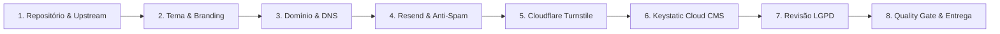

# 📋 Checklist Operacional de Onboarding de Cliente

Este documento é o guia definitivo passo a passo para colocar no ar o site institucional de um novo cliente a partir deste template. O processo é estruturado para ser concluído em **menos de 2 horas**, garantindo máxima segurança, conformidade legal (LGPD), entregabilidade de e-mails de 100% e custo fixo de **$0/mês**.

---

## 🧭 Visão Geral do Fluxo



---

## 🛠️ Etapa 1: Repositório & Branching

- [ ] **1.1. Criar repositório do cliente:**
  - No GitHub, clique em **Use this template** > **Create a new repository**.
  - Nome sugerido: `site-[nome-do-cliente]` (ex: `site-clinica-alvorada`).
  - Visibilidade: **Private** (garante privacidade dos dados cadastrais do cliente).
- [ ] **1.2. Clonar localmente:**

  ```bash
  git clone https://github.com/sua-organizacao/site-cliente.git
  cd site-cliente
  npm install
  ```

- [ ] **1.3. Vincular o Template Original como Upstream:**
  - Permite puxar atualizações futuras e patches de segurança conforme definido no [ADR 0010](adr/0010-estrategia-de-atualizacao-e-versionamento.md):

  ```bash
  git remote add template https://github.com/heviane/institutional-website-template.git
  git fetch template
  ```

- [ ] **1.4. Proteger a Branch `main`:**
  - Em `Settings` > `Branches` no GitHub, crie uma regra de proteção exigindo que o pipeline de CI (`ci.yml`) passe antes de merges.

---

## 🎨 Etapa 2: Identidade Visual & Conteúdo Base (10 minutos)

- [ ] **2.1. Configurar Dados Globais em `src/config/site.ts`:**
  - [ ] Razão Social e Nome Fantasia
  - [ ] CNPJ e Inscrição Estadual (se aplicável)
  - [ ] E-mail de atendimento (`contato@cliente.com.br`)
  - [ ] Telefone comercial e WhatsApp (com código DDI e DDD)
  - [ ] Endereço completo com CEP
  - [ ] Links de redes sociais (LinkedIn, Instagram, Facebook, etc.)
- [ ] **2.2. Configurar Cores da Marca em `src/app/globals.css`:**
  - Extrair a paleta primária da marca do cliente e substituir as variáveis em `@theme`:
    - `--color-brand-primary`
    - `--color-brand-secondary`
    - `--color-brand-accent`
- [ ] **2.3. Substituir Assets Estáticos em `/public`:**
  - [ ] `logo.svg` (Logotipo vetorizado em versão clara e escura)
  - [ ] `favicon.ico` e `favicon.svg` (Ícone de aba)
  - [ ] `apple-touch-icon.png` (180x180 px para dispositivos iOS)
  - [ ] `og-image.jpg` (1200x630 px com título, logo e slogan para redes sociais)
- [ ] **2.4. Definir Tipografia em `src/app/layout.tsx`:**
  - Ajustar a importação de `next/font/google` com as famílias tipográficas do cliente.

---

## 🌐 Etapa 3: Domínio, DNS & Hospedagem

- [ ] **3.1. Escolha e Cadastro na Plataforma de Hospedagem:**
  - **Opção A (Padrão Oficial - Recomendado): Vercel**
    - Suporte nativo completo a Next.js 15 (App Router, SSG, Server Actions) sem necessidade de adaptadores adicionais.
    - Conectar a conta GitHub, importar o repositório privado `site-cliente` e realizar o deploy inicial.
  - **Opção B (Alternativa de Custo $0 Comercial): Cloudflare Pages**
    - Conforme [ADR 0005](adr/0005-estrategia-de-hospedagem-e-cicd.md), permite uso comercial no plano gratuito.
    - *Atenção à compatibilidade:* Requer compilar com o adaptador `@cloudflare/next-on-pages` (OpenNext) para executar as Server Actions no runtime Edge da Cloudflare.
- [ ] **3.2. Configurar Domínio Personalizado na Hospedagem:**
  - Adicionar o domínio raiz (`cliente.com.br`) e o subdomínio (`www.cliente.com.br`) nas configurações do projeto.
- [ ] **3.3. Configurar Apontamentos DNS conforme a Plataforma Escolhida:**

  **Se utilizar a Vercel (Apontamentos no Registro.br, Cloudflare ou GoDaddy):**
  | Tipo | Nome / Host | Valor / Destino | TTL |
  | :--- | :--- | :--- | :--- |
  | **A** | `@` (raiz) | `76.76.21.21` | 3600 (1h) |
  | **CNAME** | `www` | `cname.vercel-dns.com.` | 3600 (1h) |

  **Se utilizar o Cloudflare Pages:**
  * *Com zona DNS já gerenciada na Cloudflare:* O domínio é vinculado automaticamente com 1 clique (gerenciamento por proxy CNAME interno).
  * *Com zona DNS externa (ex.: Registro.br sem migração de NS):*
  | Tipo | Nome / Host | Valor / Destino | TTL |
  | :--- | :--- | :--- | :--- |
  | **CNAME** | `www` (ou `@` via ALIAS/ANAME) | `<nome-do-projeto>.pages.dev.` | 3600 (1h) |

- [ ] **3.4. Validar Emissão de Certificado SSL/TLS:**
  - Aguardar a propagação do DNS e verificar se o status do domínio exibe **Valid Configuration** e o cadeado HTTPS está ativo.

---

## 📧 Etapa 4: Configuração de E-mails Transacionais (Resend & DNS Anti-Spam)

Conforme [ADR 0003](adr/0003-estrategia-de-formularios.md), formulários institucionais exigem autenticação rigorosa para evitar a caixa de spam do destinatário.

- [ ] **4.1. Criar Domínio no Resend:**
  - No painel do [Resend](https://resend.com/), vá em **Domains** > **Add Domain**.
  - Recomendado: usar o domínio principal `cliente.com.br` ou subdomínio dedicado `notificacoes.cliente.com.br`.
- [ ] **4.2. Inserir Registros DNS Fornecidos pelo Resend:**
  - [ ] **DKIM (Assinatura Criptográfica):** Registro `TXT` ou `CNAME` com nome `resend._domainkey`
  - [ ] **SPF (Autorização de Envio):** Registro `TXT` com valor:

    ```text
    v=spf1 include:amazonses.com ~all
    ```

    *(Ajuste caso o cliente já tenha SPF existente do Google Workspace/Microsoft 365, combinando os includes).*
  - [ ] **DMARC (Política de Alinhamento):** Adicionar registro `TXT` no host `_dmarc.cliente.com.br`:

    ```text
    v=DMARC1; p=none; rua=mailto:dmarc@cliente.com.br
    ```

- [ ] **4.3. Verificar Domínio no Resend:**
  - Clicar em **Verify DNS Records** no painel do Resend até todos os itens exibirem status verde (`Verified`).
- [ ] **4.4. Gerar Chave de API:**
  - Em **API Keys**, criar uma nova chave com permissão de envio (`Sending access`).
  - Copiar o valor `re_xxxxxxxxxxxx`.
- [ ] **4.5. Teste de Entregabilidade:**
  - Enviar um e-mail de teste para o [Mail-Tester](https://www.mail-tester.com/) e garantir nota mínima de **9/10**.

---

## 🛡️ Etapa 5: Proteção Anti-Abuso (Cloudflare Turnstile)

- [ ] **5.1. Criar Widget no Cloudflare Dashboard:**
  - Acesse **Turnstile** no painel do Cloudflare (plano gratuito).
  - Nome do widget: `Formulário de Contato - [Cliente]`.
  - Tipo de widget: **Managed** (invisível na maioria das vezes, sem quebra-cabeças visuais).
  - Domínios permitidos:
    - `localhost`
    - `cliente.com.br`
    - `www.cliente.com.br`
    - `*.vercel.app`
- [ ] **5.2. Obter Chaves:**
  - Copiar **Site Key** (`0x4AAAAAA...`)
  - Copiar **Secret Key** (`0x4AAAAAA...`)

---

## 📝 Etapa 6: Keystatic Cloud CMS em Produção

Conforme [ADR 0006](adr/0006-autenticacao-cms-e-gestao-de-midia.md), utilizamos o Keystatic Cloud para autenticação segura sem exigir conta de desenvolvedor no GitHub para o cliente.

- [ ] **6.1. Cadastrar Projeto no Keystatic Cloud:**
  - Acesse [keystatic.cloud](https://keystatic.cloud) e conecte com a conta GitHub da agência.
  - Crie um novo projeto apontando para o repositório privado do cliente (`site-cliente`).
  - Copiar o slug do projeto (ex: `agencia/site-cliente`).
- [ ] **6.2. Convidar o Usuário do Cliente:**
  - No painel do Keystatic Cloud, convidar o e-mail do cliente como **Editor**.
  - O cliente receberá um link seguro de acesso sem precisar entender Git.
- [ ] **6.3. Configurar Variáveis de Ambiente no Host:**
  - No painel da Vercel (ou Cloudflare Pages), em `Environment Variables`, adicionar:

    ```env
    NEXT_PUBLIC_SITE_URL=https://www.cliente.com.br
    RESEND_API_KEY=re_xxxxxxxxxxxxxxxxxxxx
    RESEND_FROM_EMAIL="Contato Cliente <contato@cliente.com.br>"
    CONTACT_EMAIL_TO=comercial@cliente.com.br
    NEXT_PUBLIC_TURNSTILE_SITE_KEY=0x4AAAAAAxxxxxxxx
    TURNSTILE_SECRET_KEY=0x4AAAAAAxxxxxxxx
    NEXT_PUBLIC_KEYSTATIC_PROJECT=agencia/site-cliente
    ```

- [ ] **6.4. Validar o CMS em Produção:**
  - Acessar `https://www.cliente.com.br/keystatic`.
  - Fazer login com o e-mail convidado.
  - Criar um post ou alterar um texto institucional.
  - Verificar se o commit foi gerado automaticamente no repositório GitHub e disparou novo build de SSG.

---

## ⚖️ Etapa 7: Conformidade Legal & Privacidade (LGPD)

Conforme [ADR 0007](adr/0007-conformidade-lgpd-e-privacidade.md):

- [ ] **7.1. Identificar o Encarregado de Dados (DPO):**
  - Obter o nome e e-mail do encarregado de dados do cliente (ex: `privacidade@cliente.com.br`).
- [ ] **7.2. Customizar as Páginas Legais:**
  - Atualizar os dados cadastrais da empresa em:
    - `src/app/(legal)/politica-de-privacidade/page.tsx`
    - `src/app/(legal)/termos-de-uso/page.tsx`
- [ ] **7.3. Validar Consentimento no Formulário:**
  - Testar envio de formulário com checkbox desmarcado (deve acusar erro de validação do Zod).
  - Testar envio com checkbox marcado (deve enviar com sucesso).

---

## 🚀 Etapa 8: Quality Gate Final & Entrega ao Cliente

- [ ] **8.1. Verificação Automatizada Local:**

  ```bash
  npm run lint
  npm run typecheck
  npm run test
  npm run build
  ```

- [ ] **8.2. Auditoria do Google Lighthouse & Core Web Vitals (Mobile):**
  - Executar auditoria na URL de produção `https://www.cliente.com.br` (perfil Mobile / 4G lento):
    - [ ] **LCP (Largest Contentful Paint):** < 2,5 s
    - [ ] **INP (Interaction to Next Paint):** < 200 ms
    - [ ] **CLS (Cumulative Layout Shift):** < 0,1
    - [ ] **Performance Score:** ≥ 90 (Mobile) / ≥ 95 (Desktop)
    - [ ] **Acessibilidade:** ≥ 95 (Zero violações no axe-core)
    - [ ] **Melhores Práticas:** ≥ 95
    - [ ] **SEO:** 100
- [ ] **8.3. Auditoria Rápida de Acessibilidade Manual:**
  - [ ] Navegação completa por teclado (`Tab`, `Shift+Tab`, `Enter`, `Espaço`) sem armadilhas de foco.
  - [ ] Anunciadores de leitor de tela nos modais e alertas de envio do formulário (`aria-live="polite"`).
- [ ] **8.4. Handover & Kit de Entrega:**
  - [ ] Enviar mensagem de boas-vindas ao cliente com:
    - Link do site oficial no ar.
    - Link de acesso ao painel CMS: `https://www.cliente.com.br/keystatic`.
    - Instruções de como criar, editar e despublicar conteúdos no Keystatic.
  - [ ] Armazenar chaves de API e credenciais em cofre seguro corporativo (Bitwarden / 1Password).
  - [ ] Agendar reunião ou vídeo de treinamento de 15 minutos com a equipe do cliente.

---

## 🆘 Resolução Rápida de Problemas Comuns (Troubleshooting)

| Sintoma | Causa Mais Frequente | Como Corrigir |
| :--- | :--- | :--- |
| **Erro de build: `ZodError` nas envs** | Falta variável obrigatória na hospedagem | Verifique o painel da Vercel e compare com `.env.example`. |
| **E-mails do formulário caem em Spam** | Falta de registro DKIM ou DMARC | Valide o domínio no Resend e teste com o [Mail-Tester](https://www.mail-tester.com/). |
| **Erro 403 no Keystatic ao publicar** | GitHub App sem permissão de escrita no repo | Reautorize o GitHub App do Keystatic Cloud nas configurações do repositório. |
| **Turnstile sempre dá erro no envio** | Domínio do site não cadastrado no Cloudflare | Adicione o domínio exato e `localhost` na lista de domínios permitidos do Turnstile. |
| **Lighthouse acusa imagens pesadas** | Imagem adicionada sem usar `next/image` ou em PNG pesado | Converta para WebP/AVIF e adicione dimensões explícitas `width` e `height`. |
