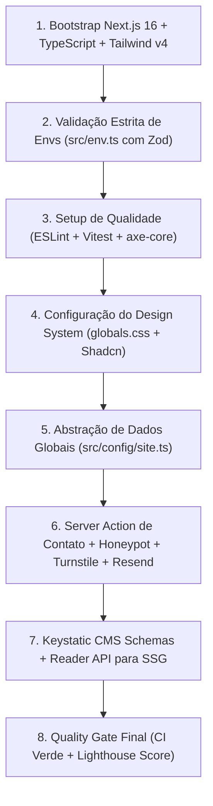

# Relatório Técnico de Revisão Arquitetural (Fase 1)

* **Status:** Concluído
* **Data da Revisão:** 2026-10-23
* **Responsável:** Engenharia de Software
* **Escopo:** Auditoria do planejamento arquitetural, governança de dados, conformidade legal e automações da Fase 1 antes do início da implementação do Core & MVP (Fase 2).

---

## 1. Objetivo e Escopo da Revisão

Este documento consolida a revisão técnica da **Fase 1 (Fundação Documental, Governança e Decisões Arquiteturais)** do `institutional-website-template`. O propósito desta auditoria é assegurar que todas as decisões registradas nos [Architectural Decision Records (ADRs)](adr/README.md) atendam a critérios rigorosos de viabilidade técnica, estabilidade operacional e previsibilidade financeira antes do início da codificação da aplicação.

---

## 2. Diagnóstico das Decisões Arquiteturais

### 2.1. Governança e Rastreabilidade Técnica (ADRs 0001 a 0011)

* **Registro Formal:** A adoção de 11 ADRs com índice centralizado em [docs/adr/README.md](adr/README.md) formaliza as motivações, alternativas consideradas e trade-offs assumidos pela arquitetura.
* **Redução de Ambiguidade:** A documentação elimina decisões tácitas, garantindo que qualquer desenvolvedor compreenda a escolha do Next.js 16 ([ADR 0001](adr/0001-escolha-do-framework-next.md)), do Keystatic CMS ([ADR 0002](adr/0002-escolha-do-cms-keystatic.md)) e da infraestrutura de CI/CD ([ADR 0005](adr/0005-estrategia-de-hospedagem-e-cicd.md)).

### 2.2. Viabilidade e Sustentabilidade de Custos

* **Modelo Otimizado:** Conforme consolidado na Matriz Financeira de [docs/07-client-onboarding-checklist.md](07-client-onboarding-checklist.md), o template prioriza o uso de camadas gratuitas dos serviços (GitHub, Vercel, Resend, Cloudflare Turnstile, Upstash Redis e Keystatic Cloud), estabelecendo limites claros e gatilhos de upgrade para planos pagos.
* **Titularidade Mandatória do Cliente:** A arquitetura define como regra mandatória a criação de contas e faturamento em nome da empresa do cliente, blindando a agência/desenvolvedor de custos de terceiros.

### 2.3. Defesa de Formulários e Proteção da Cota de Mensageria

* **Defesa em Camadas ([ADR 0003](adr/0003-estrategia-de-formularios.md) e [ADR 0011](adr/0011-defesa-antispam-e-protecao-de-formularios.md)):** A integração de campo Honeypot, Cloudflare Turnstile e Rate Limiting por IP (Upstash Redis em produção) protege a cota de 100 e-mails/dia do plano gratuito da API do Resend contra esgotamento por bots automatizados.
* **Fronteira Pública:** A Server Action é formalmente tratada como interface de entrada não confiável (*untrusted boundary*), com revalidação estrita via Zod no servidor.

### 2.4. Governança de Privacidade e LGPD por Design ([ADR 0007](adr/0007-conformidade-lgpd-e-privacidade.md))

* **Retenção Efêmera:** Mensagens de contato não são persistidas em bancos de dados relacionais; os dados trafegam de forma criptografada para a caixa postal corporativa do cliente, atendendo à minimização de dados.
* **Bases Legais Flexíveis:** A documentação distingue a base de execução de procedimentos contratuais preliminares (Art. 7º, V) da necessidade de consentimento expresso (Art. 7º, I), disponibilizando o schema Zod como salvaguarda configurável.
* **Telemetria sem Cookies:** O uso do Plausible Analytics elimina a necessidade de CMPs (*Cookie Banners*) intrusivos, mantendo o dever de informar na Política de Privacidade.

### 2.5. Métricas Objetivas de Performance e Qualidade

* **Core Web Vitals:** Metas estritas definidas para ambiente móvel: LCP < 2,5 s, INP < 200 ms e CLS < 0,1.
* **Acessibilidade:** Conformidade WCAG 2.1 AA auditada via testes com `vitest-axe` nos primitivos Radix UI ([ADR 0004](adr/0004-design-system-e-estilizacao.md)).

---

## 3. Limitações e Riscos Técnicos Monitorados

A revisão identificou **quatro pontos de atenção técnica** a serem monitorados durante a implementação:

### 3.1. Transição Planejamento vs. Código

* **Cenário:** O projeto concluiu a fase documental, estando com o bootstrapping de código pendente.
* **Ação Preventiva:** A inicialização do Next.js 16, Tailwind v4 e React 19 deve seguir estritamente as dependências compatíveis com Node.js 24 LTS, ativando imediatamente a validação de ambiente com Zod (`src/env.ts`).

### 3.2. Testabilidade e Isolamento de Serviços Externos

* **Cenário:** A Server Action integra múltiplos provedores externos (Cloudflare Turnstile, Resend API e Upstash Redis).
* **Ação Preventiva:** A lógica de envio e verificação deve ser desacoplada em serviços modulares injetáveis para permitir testes unitários e de integração no Vitest via *mocks*, evitando chamadas de rede no CI do GitHub Actions.

### 3.3. Plataforma de Referência e Compatibilidade de Runtime

* **Cenário:** A Vercel é a plataforma de referência oficial do MVP. A hospedagem no Cloudflare Pages exige compilação via adaptadores de Edge/OpenNext (`@cloudflare/next-on-pages`) e loader customizado de imagens.
* **Ação Preventiva:** Manter o onboarding focado na Vercel e isolar a Cloudflare como guia técnico de expansão sob demanda pós-MVP ([ADR 0005](adr/0005-estrategia-de-hospedagem-e-cicd.md)).

### 3.4. Validação Empírica da Sincronização de Templates

* **Cenário:** O comando `git merge --allow-unrelated-histories` em repositórios derivados via template pode acarretar conflitos por falta de ancestral comum (*merge-base*).
* **Ação Preventiva:** Manter o protocolo sob validação empírica na Fase 2 do Roadmap, executando testes de derivação práticos para comparar merge direto, patches cirúrgicos e workflows de sincronização automatizada ([ADR 0010](adr/0010-estrategia-de-atualizacao-e-versionamento.md)).

---

## 4. Roteiro Sequencial para a Fase 2 (Core & MVP)

A execução do código da Fase 2 deve seguir a seguinte ordem de dependências técnicas:

1. **Bootstrap da Aplicação:** Instalação das dependências estruturais do projeto e configuração dos scripts estritos de CI no `package.json` (`lint`, `typecheck`, `test`, `build`).
2. **Validação de Ambiente:** Implementação de `src/env.ts` para falha rápida (*fail-fast*) no build caso variáveis obrigatórias não sejam declaradas.
3. **Qualidade Automatizada:** Homologação do pipeline `.github/workflows/ci.yml` no primeiro commit funcional de código.
