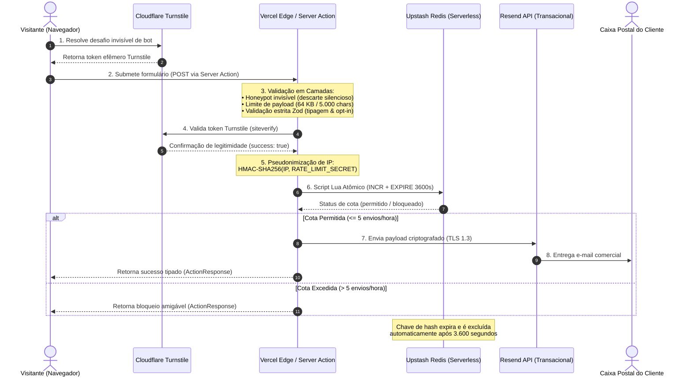

# 10 - Arquitetura de Fluxo de Dados e Conformidade LGPD (Data Flow & Privacy Blueprint)

Este documento descreve detalhadamente a arquitetura de tráfego, processamento e descarte de dados pessoais do **`institutional-website-template`**. Foi elaborado para servir como referência técnica para engenheiros de software, encarregados de dados (DPOs), consultores jurídicos e auditores de conformidade com a Lei Geral de Proteção de Dados (LGPD - Lei nº 13.709/2018).

---

## 🏛️ 1. Princípio Arquitetural Central: Retenção Zero (Zero-Database)

Em estrita consonância com a [ADR 0007](adr/0007-conformidade-lgpd-e-privacidade.md), o template implementa uma **Arquitetura Sem Banco de Dados Relacional (*Zero-Database Architecture*)**:
* A aplicação **não mantém bancos de dados permanentes** (PostgreSQL, MySQL, MongoDB ou similares) para armazenar cadastros, contatos ou mensagens de visitantes.
* As informações enviadas por meio do formulário de contato são transmitidas de ponta a ponta como um fluxo efêmero de mensagens para a caixa de e-mail corporativa do cliente via **Resend API**.
* O armazenamento temporário em infraestrutura de nuvem limita-se exclusivamente a **contadores anônimos de Rate Limiting com tempo de vida curto (TTL de 3.600 segundos)** no Upstash Redis.

---

## 🗺️ 2. Diagrama de Fluxo de Dados Ponta a Ponta

O fluxo a seguir ilustra a jornada percorrida por cada pacote de dados desde a submissão pelo visitante até a entrega final e descarte dos artefatos efêmeros:

---

## 📋 3. Inventário Detalhado dos Dados Coletados

| Dado Pessoal | Finalidade Operacional | Base Legal (LGPD) | Onde Trafega | Tempo de Retenção |
| :--- | :--- | :--- | :--- | :--- |
| **Nome Completo** | Identificação do contato para resposta comercial | Art. 7º, V (Execução de pré-contrato) | Trânsito em memória (Vercel) e entrega via Resend | Efêmero na infraestrutura; retido apenas na caixa postal do cliente. |
| **E-mail Corporativo/Pessoal** | Canal de resposta à solicitação enviada | Art. 7º, V (Execução de pré-contrato) | Trânsito em memória (Vercel) e entrega via Resend | Efêmero na infraestrutura; retido apenas na caixa postal do cliente. |
| **Telefone / WhatsApp** | Contato telefônico direto (opcional ou obrigatório) | Art. 7º, V (Execução de pré-contrato) | Trânsito em memória (Vercel) e entrega via Resend | Efêmero na infraestrutura; retido apenas na caixa postal do cliente. |
| **Mensagem / Demanda** | Descrição do projeto ou dúvida institucional | Art. 7º, V (Execução de pré-contrato) | Trânsito em memória (Vercel) e entrega via Resend | Efêmero na infraestrutura; retido apenas na caixa postal do cliente. |
| **Endereço IP** | Proteção contra ataques de negação de serviço e abuso (Anti-Spam) | Art. 7º, IX (Legítimo interesse do controlador) | Processado no Edge da Vercel; **nunca persistido em texto claro** | **Pseudonimizado imediatamente**; o hash expira em no máximo 1 hora. |
| **Consentimento / Opt-in** | Confirmação de concordância com os Termos e Política | Art. 7º, I (Consentimento expresso) | Validado pelo Zod no servidor | Registro da ação anexado ao corpo do e-mail entregue. |

---

## 🔒 4. Pseudonimização Técnica de Endereço IP (LGPD Art. 13, §4º)

Em conformidade rigorosa com o **Art. 13, §4º da LGPD**, o repositório reconhece que o hash de um endereço IP associado a uma chave secreta mantida sob controle do controlador constitui tecnicamente um **dado pessoal pseudonimizado** (e não anonimizado de forma absoluta e irreversível), pois a reversão teórica seria possível mediante posse da chave secreta e força bruta sobre o espaço de endereçamento IPv4/IPv6.

### Como a pseudonimização é implementada no código:
1. O endereço IP real é extraído de cabeçalhos seguros de proxy reverso (`cf-connecting-ip`, `x-real-ip` ou `x-forwarded-for`).
2. O sistema calcula a assinatura criptográfica:
   $$\text{Hash} = \text{HMAC-SHA256}(\text{IP}, \text{RATE\_LIMIT\_SECRET})$$
3. Apenas a string resultante do digest hexadecimal é transmitida ao Redis como parte da chave de chaveamento: `rate_limit:contact:<hash>`.
4. O endereço IP original é imediatamente descartado da memória da Server Action.
5. A chave é configurada com **auto-expiração atômica (TTL de 3.600 segundos)** no Upstash Redis via script Lua, garantindo destruição matemática após 1 hora.

---

## 🌍 5. Transferência Internacional de Dados (LGPD Art. 33)

Como o website utiliza provedores globais de infraestrutura em nuvem, a operação envolve a **transferência internacional de dados pessoais**, expressamente amparada pelo Art. 33, incisos II e IX da LGPD e transparente na Política de Privacidade:

| Subprocessador | Sede Corporativa | Papel no Tratamento | Salvaguardas Técnicas e Legais |
| :--- | :--- | :--- | :--- |
| **Vercel Inc.** | Estados Unidos | Hospedagem de infraestrutura Edge/Serverless e processamento da Server Action | Criptografia TLS 1.3 em trânsito, certificação SOC 2 Type II e ISO 27001. |
| **Resend Inc.** | Estados Unidos | Despacho transacional de mensagens e encaminhamento SMTP | Criptografia em repouso (AES-256), TLS em trânsito e acordos de processamento de dados (DPA). |
| **Upstash Inc.** | Estados Unidos / UE | Armazenamento efêmero em cache do hash pseudonimizado de Rate Limiting | Criptografia em trânsito e em repouso, servidores com retenção volátil em memória. |
| **Cloudflare Inc.** | Estados Unidos | Mitigação de bots (Turnstile) e proteção perimetral de DNS/WAF | Processamento de telemetria sem uso de cookies invasivos de rastreamento de terceiros. |

---

## 📄 6. Modelo de Declaração para o DPO / Jurídico do Cliente

> **Declaração de Conformidade Técnica do Website Institucional**  
> *"O website institucional desenvolvido sob a arquitetura `institutional-website-template` opera sob a modalidade Zero-Database, não mantendo bases relacionais ou armazenamento persistente de dados coletados por formulários. Todos os dados preenchidos no formulário de contato têm a finalidade exclusiva de viabilizar o retorno comercial solicitado pelo usuário (Art. 7º, V da LGPD). O endereço IP do usuário é submetido a algoritmo criptográfico HMAC-SHA256 para controle estrito de abuso, sendo descartado automaticamente em até 3.600 segundos. Não são utilizados cookies de terceiros para publicidade comportamental ou rastreamento cruzado de navegação sem consentimento."*

