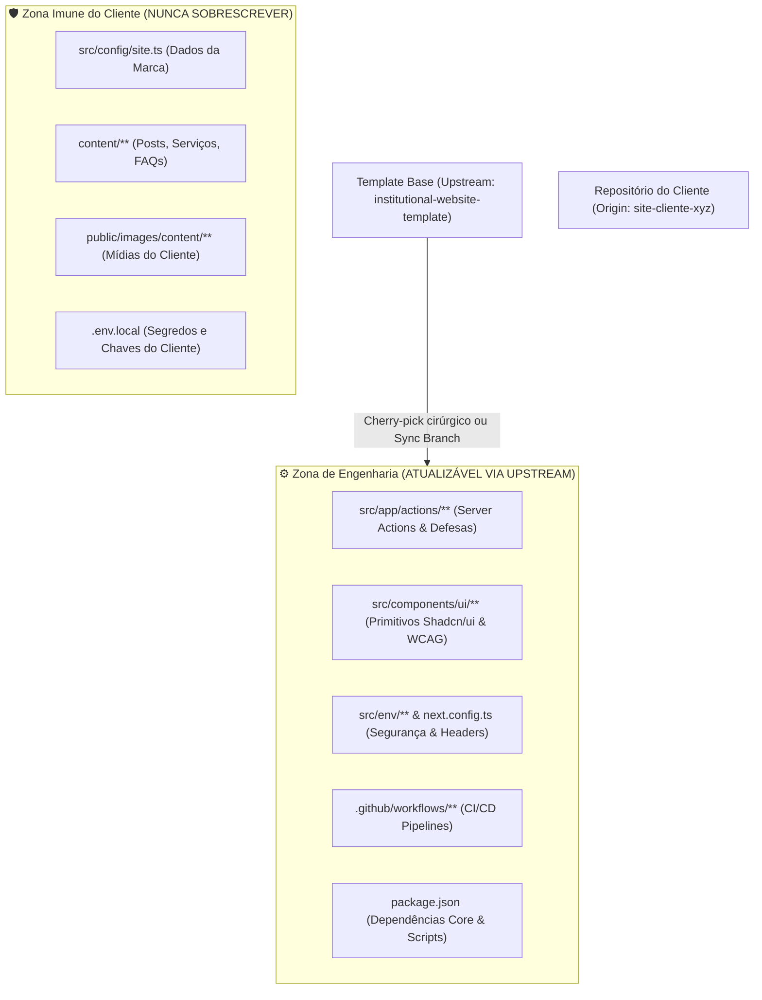

# 11 - Playbook de Manutenção e Sincronização de Forks (Upstream Maintenance)

Este documento estabelece o procedimento operacional padrão para desenvolvedores e agências que gerenciam websites de clientes criados a partir do **`institutional-website-template`**. Seu objetivo é garantir que melhorias de engenharia, correções de segurança e novas funcionalidades do template base possam ser propagadas para os repositórios dos clientes com **risco zero de sobrescrita de conteúdo ou quebra de personalização visual**.

---

## 🧭 1. Fundamentos e Filosofia de Atualização

Conforme deliberado no [ADR 0010](adr/0010-estrategia-de-atualizacao-e-versionamento.md), a separação clara de responsabilidades é a chave para atualizações seguras:



---

## 🛠️ 2. Configuração Inicial do Repositório do Cliente

Em qualquer clone local do repositório de um cliente específico, configure o ponteiro para o repositório upstream original do template:

```bash
# 1. Verifique os remotes atuais (geralmente aponta apenas para origin)
git remote -v

# 2. Adicione o template base como upstream (faça apenas uma vez por clone)
git remote add upstream https://github.com/heviane/institutional-website-template.git

# 3. Confirme que o remote upstream foi registrado corretamente
git remote -v
# Deve exibir:
# origin    https://github.com/sua-agencia/site-cliente-xyz.git (fetch & push)
# upstream  https://github.com/heviane/institutional-website-template.git (fetch & push)
```

---

## 🚀 3. Estratégias de Propagação de Atualizações

### 🌟 Estratégia A: Patch Cirúrgico via `cherry-pick` (Altamente Recomendada)

Para correções de segurança, correções de bugs em Server Actions ou melhorias pontuais de componentes, aplique commits específicos sem trazer o histórico completo:

```bash
# 1. Garanta que a sua branch de trabalho está limpa e atualizada
git checkout main
git pull origin main

# 2. Busque as atualizações mais recentes do template upstream
git fetch upstream

# 3. Crie uma branch de atualização dedicada
git checkout -b chore/sync-security-patch

# 4. Aplique o commit específico desejado do upstream
git cherry-pick <hash-do-commit-do-upstream>

# 5. Se o commit envolver apenas a Zona de Engenharia, o cherry-pick será limpo.
# Caso haja algum conflito pontual, resolva mantendo sempre a versão do cliente para a Zona Imune.
```

---

### 📦 Estratégia B: Sincronização de Nova Versão Maior/Menor via Branch Dedicada

Quando o template base lançar uma nova versão consolidada (ex.: de `v1.1.0` para `v1.2.0`):

```bash
# 1. Crie uma branch de sincronização a partir da main do cliente
git checkout -b sync/template-v1.2.0

# 2. Mescle a tag de release do upstream dentro da branch de sincronização
git merge upstream/v1.2.0 --no-commit

# 3. Verifique imediatamente os arquivos modificados
git status

# 4. RESTAURAÇÃO COMPULSÓRIA DA ZONA IMUNE DO CLIENTE:
# Se o merge marcar alterações em arquivos do cliente, reverta-os imediatamente:
git checkout HEAD -- src/config/site.ts
git checkout HEAD -- content/
git checkout HEAD -- public/images/content/

# 5. Finalize o commit de merge
git commit -m "chore(template): sync upstream updates to v1.2.0"
```

> [!WARNING]
> **Por que NUNCA usar `git merge --allow-unrelated-histories` de forma leviana?**  
> Esse comando força a união de grafos Git desconectados, criando conflitos em cascata em todos os arquivos de configuração do repositório. Prefira sempre o fluxo de branch isolada com inspeção visual ou `cherry-pick`.

---

## 🧩 4. Resolução de Conflitos em Dependências (`package.json`)

Se o upstream atualizou versões de pacotes e o cliente adicionou dependências próprias (ex.: uma biblioteca gráfica ou analytics):

1. **Abra o `package.json` no editor:**
   * Mantenha as versões mais recentes das dependências essenciais do template (`next`, `react`, `zod`, `resend`, `@upstash/redis`, etc.).
   * Preserve as dependências exclusivas adicionadas para o cliente.
2. **Reconstrua o Lockfile Determinístico:**
   ```bash
   # Remova o node_modules e regenere o lockfile de forma limpa
   npm install
   ```
3. **Execute os testes imediatamente:**
   ```bash
   npm test
   ```

---

## ✅ 5. Checklist Obrigatório de Verificação Pós-Sincronização

Antes de fazer o push e acionar o deploy de produção no repositório do cliente, execute compulsoriamente os Quality Gates unificados:

```bash
# 1. Executar a verificação integral
npm run verify
```

O comando acima assegura que:
* [x] **Documentação:** Nenhum link interno foi quebrado (`audit:docs`).
* [x] **Estilo e Boas Práticas:** Zero violações no ESLint (`lint`).
* [x] **Tipagem:** TypeScript compila sem erros estritos (`typecheck`).
* [x] **Testes Automatizados:** Todos os testes unitários e de acessibilidade WCAG 2.1 AA passaram (`test`).
* [x] **Build de Produção:** Compilação estática do Next.js 16 conclui com sucesso (`build`).

### 🧪 Teste Humano de Sanidade (Smoke Test)
1. Rode `npm run dev` localmente.
2. Acesse a Home Page e confirme que o visual da marca, logotipo e cores do cliente permanecem intactos.
3. Submeta um formulário de teste e confirme o recebimento do e-mail.
4. Acesse `/keystatic` e confirme que as coleções de conteúdo abrem normalmente.

