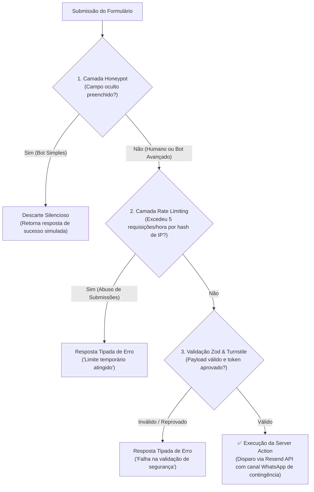

# ADR 0011: Defesa Anti-Spam, Proteção de Formulários e Rate Limiting

* **Status:** Aceito
* **Data:** 2026-10-22
* **Decisores:** Engenharia de Software / Autor do Projeto

---

## 1. Contexto (Context)

Formulários institucionais de contato ("Fale Conosco", solicitação de orçamentos e agendamento de reuniões) são alvos constantes de robôs automatizados (*spambots*), *scrapers* e *scripts* maliciosos que varrem a internet em busca de campos abertos para envio massivo de mensagens.

No contexto do `institutional-website-template`, a ausência de uma barreira anti-spam eficiente acarreta três problemas críticos:

1. **Esgotamento Imediato da Cota Gratuita (Pilar de Baixo Custo / Eficiência Financeira):**
   Conforme definido no [ADR 0003](0003-estrategia-de-formularios.md), utilizamos a API do Resend no plano gratuito, que impõe um limite estrito de **100 e-mails por dia**. Um ataque automatizado de poucos minutos pode esgotar toda a cota diária do cliente, impedindo o recebimento de leads comerciais reais e causando prejuízo direto ao negócio.

2. **Conflito com Privacidade e LGPD (Pilar de Governança):**
   Mecanismos como o Google reCAPTCHA v2 e v3 utilizam cookies e identificadores de terceiros vinculados ao ecossistema de serviços da Google, gerando atrito de privacidade e compelindo a inserção de banners de consentimento de cookies para mitigar riscos regulatórios.

3. **Acessibilidade e Desempenho (Core Web Vitals & WCAG 2.1 AA):**
   Desafios visuais complexos (identificar faixas de pedestre, semáforos ou caracteres distorcidos) quebram a acessibilidade para pessoas que usam leitores de tela ou possuem limitações motoras/cognitivas. Além disso, bibliotecas pesadas de CAPTCHA aumentam significativamente o tempo de bloqueio da thread principal (*Total Blocking Time* - TBT) e prejudicam o *Interaction to Next Paint* (INP).

---

## 2. Decisão (Decision)

Decidimos implementar uma **arquitetura de defesa anti-spam em três camadas**, combinando métodos invisíveis locais e validação em nuvem sem rastreamento de usuários:

### Detalhamento das Camadas de Proteção:

### 1. Camada 1: Honeypot Oculto via CSS/Aria

* Inclui um campo de formulário adicional chamado `honeypot` (ou campo com rótulo engenhoso como `website`).
* O campo é completamente invisível para usuários humanos por meio de posicionamento absoluto fora da tela (`position: absolute; left: -9999px; opacity: 0; pointer-events: none;`), com `tabIndex={-1}`, `autoComplete="off"` e `aria-hidden="true"`.
* *Spambots* ingênuos leem o DOM cru e preenchem todos os campos automaticamente. Se o campo contiver qualquer caractere no momento da submissão na Server Action, a requisição é descartada imediatamente, retornando uma resposta de sucesso simulada (`{ success: true, message: "Mensagem enviada com sucesso!" }`) para despistar o robô e evitar novas tentativas em lote.

### 2. Camada 2: Rate Limiting por Hash Criptográfico de IP (Janela Fixa com TTL Relativo)

* **Ordem de Execução Otimizada:** Executado antes de chamadas de rede externas para economizar recursos e requisições à API do Turnstile e do Resend.
* **Finalidade e Limites:** Aplica uma política configurável de moderação (padrão de até **5 requisições por janela fixa de 1 hora por visitante**) para conter abusos repetitivos e cliques acidentais originados da mesma máquina/conexão.
* **Conformidade com LGPD e Consistência Serverless:** Endereços IP brutos são dados pessoais segundo a LGPD e nunca devem ser persistidos. Em arquiteturas serverless com múltiplas instâncias concorrentes, salts puramente aleatórios em memória quebram o rate limiting (cada container geraria uma chave distinta no Redis). Para resolver isso com segurança e privacidade, a chave no armazenamento é computada via **HMAC com segredo estável de servidor e auto-expiração via TTL**: `HMAC-SHA256(ip, RATE_LIMIT_SECRET)` com expiração estrita de curto prazo (TTL atômico de 1 hora / 3.600 segundos). Essa abordagem garante que todas as instâncias serverless calculem rigorosamente a mesma chave no Redis para aquele IP sem persistir IPs brutos (privacidade por design), enquanto o TTL atômico elimina a chave logo após o período de janela, sem resíduos de dados e sem anomalias na virada da meia-noite.
* **Extração Segura de IP sem Forjamento:** A Server Action prioriza cabeçalhos validados e injetados pelo gateway de borda (`x-real-ip` na Vercel ou `cf-connecting-ip` na Cloudflare), evitando que atacantes forjem cabeçalhos `x-forwarded-for` enviados pelo próprio cliente para contornar o limite.
* **Estratégia de Armazenamento por Ambiente:**
  * **Desenvolvimento Local (`npm run dev`):** Utiliza armazenamento volátil em memória (`Map` nativo com TTL) para garantir inicialização rápida e zero atrito sem exigir credenciais externas.
  * **Produção Serverless / Edge:** Em ambientes como a Vercel, as instâncias de Server Actions são efêmeras, sem estado compartilhado e descartadas a qualquer momento. Um contador em memória RAM local não garante limite global entre diferentes instâncias serverless. Portanto, em produção, é mandatório utilizar armazenamento compartilhado com operações atômicas e expiração TTL via **Upstash Redis** (plano gratuito com até 10.000 requisições/dia, alinhado ao pilar de baixo custo) ou Vercel KV.

### 3. Camada 3: Cloudflare Turnstile (Modo Gerenciado / Invisível)

* Solução de validação de clientes baseada em desafios criptográficos e verificação técnica de características do navegador em tempo de execução (sinais de ambiente e interação não invasiva), **sem gravação de cookies persistentes de rastreamento publicitário** e sem exigir que o usuário resolva quebra-cabeças visuais.
* O widget gera um token efêmero (`cf-turnstile-response`) no frontend.
* A Server Action valida esse token diretamente na API da Cloudflare (`https://challenges.cloudflare.com/turnstile/v0/siteverify`) com a chave secreta do cliente antes de acionar a Resend API.
* Em ambientes locais de desenvolvimento e CI, o token e a verificação externa admitem bypass controlado caso as chaves não estejam configuradas no `.env.local`. Em produção, a presença das chaves e do token é estritamente exigida no schema e na Server Action.

### 4. Monitoramento de Cota, Tratamento de Falhas e Procedimento de Contingência

Mesmo com defesa em camadas, nenhuma barreira web garante proteção absoluta contra todo tipo de abuso distribuído ou picos atípicos de tráfego legítimo. Para mitigar riscos e evitar paradas operacionais silenciosas, adota-se um protocolo de contingência em três níveis:

* **Alertas Proativos de Consumo:** Ativação de notificações automáticas no painel do Resend quando o consumo diário atingir 80% e 100% da cota.
* **Tratamento Gracioso na Server Action:** Se a API do Resend retornar erro de limite excedido (`429 Too Many Requests` ou cota diária esgotada), a Server Action captura a exceção, mascara a falha interna e retorna uma resposta amigável instruindo o visitante a utilizar canais diretos alternativos (como WhatsApp corporativo ou e-mail de contato declarados em `src/config/site.ts`).
* **Procedimento Operacional de Resposta:** Diante do esgotamento da cota, a empresa cliente possui duas alternativas claras documentadas na Matriz Financeira: aguardar a renovação automática da janela de 24 horas (00:00 UTC) sem custos adicionais, ou acionar o upgrade imediato para o plano Resend Pro ($20/mês) caso o volume decorra de alta demanda comercial legítima.

---

## 3. Consequências e Trade-offs (Consequences)

### Positivas (Benefícios):

* **Redução Significativa de Abuso e Preservação da Cota:** Mitiga o esgotamento prematuro do limite diário do Resend (100 envios/dia) ao descartar bots simples via Honeypot, conter envios repetitivos via Rate Limiting anônimo e filtrar automações via Turnstile.
* **Minimização de Dados e Finalidade Exclusiva de Segurança:** O Cloudflare Turnstile opera sem cookies de rastreamento publicitário entre domínios e não comercializa dados de visitantes para monetização de anúncios. Os metadados técnicos de requisição e sinais de desafio coletados destinam-se exclusivamente à avaliação de segurança e prevenção a fraudes (legítimo interesse / proteção contra abusos), devendo esse tratamento constar de forma transparente na Política de Privacidade.
* **Acessibilidade Inclusiva (WCAG 2.1 AA):** O fluxo é 100% transparente para usuários legítimos, sem quebra-cabeças visuais que barram usuários com deficiência.
* **Impacto Mínimo em Performance:** O script do Turnstile carrega de forma assíncrona (`defer`) e adiciona menos de 20 KB gzipped, mantendo o LCP e INP dentro das metas do Core Web Vitals.

### Negativas (Riscos e Desvantagens Aceitas):

* **Proteção Probabilística, Não Absoluta:** A arquitetura reduz drasticamente a incidência de spam, mas não fornece imunidade matemática absoluta contra redes de bots altamente distribuídas ou ataques dirigidos, tornando mandatória a vigilância de cotas e o canal de contingência.
* **Configuração Extra no Onboarding:** Exige criar um widget gratuito no Cloudflare Dashboard e adicionar as variáveis `NEXT_PUBLIC_TURNSTILE_SITE_KEY` e `TURNSTILE_SECRET_KEY` para cada cliente.
* **Dependência Externa de Validação:** Se a API de verificação do Turnstile sofrer indisponibilidade momentânea, envios legítimos podem ser rejeitados temporariamente.
* **Armazenamento Centralizado para Rate Limit em Produção:** Devido à natureza efêmera e sem estado das funções Serverless, o rate limiting em produção não pode depender de memória local, exigindo credenciais de um banco Redis Serverless compartilhado (Upstash Redis) com expiração atômica.
* **Limitação contra Botnets Distribuídas:** O bloqueio por IP não protege contra ataques com IPs rotativos massivos; essa responsabilidade recai primordialmente sobre as Camadas 1 (*Honeypot*) e 3 (*Turnstile*).

---

## 4. Alternativas Consideradas

* **Google reCAPTCHA v2 ("Não sou um robô" com imagens):**
  * *Descartado:* Péssima experiência do usuário em dispositivos móveis, barreira de acessibilidade e quebra do pilar LGPD devido ao uso de cookies de rastreamento da Google.
* **Google reCAPTCHA v3 (Pontuação de Risco Invisível):**
  * *Descartado:* Continua injetando cookies de perfilamento da Google, possui script pesado que degrada o Lighthouse e frequentemente gera falsos positivos em usuários que utilizam navegadores focados em privacidade (Brave, Firefox, extensões anti-tracking).
* **hCaptcha:**
  * *Descartado:* No plano gratuito, apresenta quebra-cabeças visuais excessivamente complexos e lentos, aumentando as taxas de abandono de formulários.
* **Desafios Matemáticos Simples (ex: "Quanto é 3 + 4?"):**
  * *Descartado:* Facilmente quebrados por inteligência artificial e scripts com OCR, além de criar atrito cognitivo desnecessário para o visitante.

---
