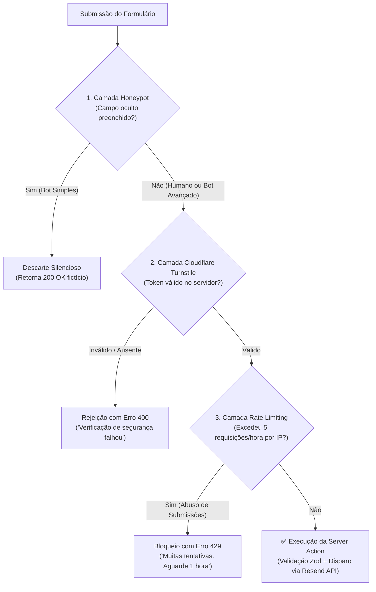

# ADR 0011: Defesa Anti-Spam, Proteção de Formulários e Rate Limiting

* **Status:** Aceito
* **Data:** 2026-10-22
* **Decisores:** Engenharia de Software / Autor do Projeto

---

## 1. Contexto (Context)

Formulários institucionais de contato ("Fale Conosco", solicitação de orçamentos e agendamento de reuniões) são alvos constantes de robôs automatizados (*spambots*), *scrapers* e *scripts* maliciosos que varrem a internet em busca de campos abertos para envio massivo de mensagens.

No contexto do `institutional-website-template`, a ausência de uma barreira anti-spam eficiente acarreta três problemas críticos:

1. **Esgotamento Imediato da Cota Gratuita (Pilar de Custo $0):**
   Conforme definido no [ADR 0003](0003-estrategia-de-formularios.md), utilizamos a API do Resend no plano gratuito, que impõe um limite estrito de **100 e-mails por dia**. Um ataque automatizado de poucos minutos pode esgotar toda a cota diária do cliente, impedindo o recebimento de leads comerciais reais e causando prejuízo direto ao negócio.

2. **Conflito com Privacidade e LGPD (Pilar de Governança):**
   Mecanismos tradicionais como o Google reCAPTCHA v2 e v3 utilizam cookies de terceiros e coletam dados comportamentais do usuário para enriquecer perfis de publicidade da Google. Isso viola a premissa de *Privacy by Design* ([ADR 0007](0007-conformidade-lgpd-e-privacidade.md)) e forçaria a inclusão de banners intrusivos de consentimento de cookies na aplicação.

3. **Acessibilidade e Desempenho (Core Web Vitals & WCAG 2.1 AA):**
   Desafios visuais complexos (identificar faixas de pedestre, semáforos ou caracteres distorcidos) quebram a acessibilidade para pessoas que usam leitores de tela ou possuem limitações motoras/cognitivas. Além disso, bibliotecas pesadas de CAPTCHA aumentam significativamente o tempo de bloqueio da thread principal (*Total Blocking Time* - TBT) e prejudicam o *Interaction to Next Paint* (INP).

---

## 2. Decisão (Decision)

Decidimos implementar uma **arquitetura de defesa anti-spam em três camadas**, combinando métodos invisíveis locais e validação em nuvem sem rastreamento de usuários:

### Detalhamento das Camadas de Proteção:

### 1. Camada 1: Honeypot Oculto via CSS/Aria

* Inclui um campo de formulário adicional chamado `website` ou `company_fax`.
* O campo é completamente invisível para usuários humanos por meio de posicionamento absoluto fora da tela (`position: absolute; left: -9999px; opacity: 0; pointer-events: none;`), com `tabIndex={-1}`, `autoComplete="off"` e `aria-hidden="true"`.
* *Spambots* ingênuos leem o DOM cru e preenchem todos os campos automaticamente. Se o campo contiver qualquer caractere no momento da submissão na Server Action, a requisição é descartada imediatamente, retornando uma resposta de sucesso simulada para enganar o robô e evitar novas tentativas em lote.

### 2. Camada 2: Cloudflare Turnstile (Modo Gerenciado / Invisível)

* Solução moderna de validação de navegadores baseada em desafios criptográficos não interativos e biometria comportamental em tempo de execução, **sem utilizar cookies de rastreamento** e sem exigir que o usuário resolva quebra-cabeças visuais.
* O widget gera um token efêmero (`cf-turnstile-response`) no frontend.
* A Server Action valida esse token diretamente na API da Cloudflare (`https://challenges.cloudflare.com/turnstile/v0/siteverify`) com a chave secreta do cliente antes de acionar a Resend API.

### 3. Camada 3: Rate Limiting por IP (Janela Deslizante Configurável)

* **Finalidade e Limites:** Aplica uma política configurável de moderação (padrão de até **5 requisições por hora por endereço IP**) para conter abusos repetitivos e cliques acidentais originados da mesma máquina/conexão.
* **Importante (Alinhamento de Escopo):** O rate limiting por IP **não** é uma garantia contra ataques massivos distribuídos (botnets com centenas de IPs rotativos). A contenção real de robôs distribuídos é desempenhada pelas Camadas 1 (*Honeypot*) e 2 (*Turnstile*).
* **Estratégia de Armazenamento por Ambiente:**
  * **Desenvolvimento Local (`npm run dev`):** Utiliza armazenamento volátil em memória (`Map` nativo com TTL) para garantir inicialização rápida e zero atrito sem exigir credenciais externas.
  * **Produção Serverless / Edge:** Em ambientes como a Vercel, as instâncias de Server Actions são efêmeras, sem estado compartilhado e descartadas a qualquer momento. Um contador em memória RAM local não garante limite global entre diferentes instâncias serverless. Portanto, em produção, é mandatório utilizar armazenamento compartilhado com operações atômicas e expiração TTL via **Upstash Redis** (plano gratuito com até 10.000 requisições/dia, mantendo o pilar de custo $0) ou Vercel KV.

---

## 3. Consequências e Trade-offs (Consequences)

### Positivas (Benefícios):

* **Blindagem Total da Cota do Resend:** Garante que o limite de 100 envios/dia fique 100% reservado para visitantes e clientes legítimos.
* **Privacidade e Conformidade LGPD por Padrão:** O Cloudflare Turnstile não lê dados pessoais, não vende informações para anunciantes e não instala cookies de rastreamento entre domínios.
* **Acessibilidade Inclusiva (WCAG 2.1 AA):** O fluxo é 100% transparente para usuários legítimos, sem quebra-cabeças visuais que barram usuários com deficiência.
* **Impacto Mínimo em Performance:** O script do Turnstile carrega de forma assíncrona (`defer`) e adiciona menos de 20 KB gzipped, mantendo o LCP e INP dentro das metas do Core Web Vitals.

### Negativas (Riscos e Desvantagens Aceitas):

* **Configuração Extra no Onboarding:** Exige criar um widget gratuito no Cloudflare Dashboard e adicionar as variáveis `NEXT_PUBLIC_TURNSTILE_SITE_KEY` e `TURNSTILE_SECRET_KEY` para cada cliente.
* **Dependência Externa de Validação:** Se a API de verificação do Turnstile sofrer indisponibilidade momentânea, envios legítimos podem ser rejeitados temporariamente.
* **Armazenamento Centralizado para Rate Limit em Produção:** Devido à natureza efêmera e sem estado das funções Serverless, o rate limiting em produção não pode depender de memória local, exigindo credenciais de um banco Redis Serverless compartilhado (Upstash Redis) com expiração atômica.
* **Limitação contra Botnets Distribuídas:** O bloqueio por IP não protege contra ataques com IPs rotativos massivos; essa responsabilidade recai exclusivamente sobre as Camadas 1 (*Honeypot*) e 2 (*Turnstile*).

---

## 4. Alternativas Consideradas

* **Google reCAPTCHA v2 ("Não sou um robô" com imagens):**
  * *Descartado:* Péssima experiência do usuário em dispositivos móveis, barreira de acessibilidade e quebra do pilar LGPD devido ao uso de cookies de rastreamento da Google.
* **Google reCAPTCHA v3 (Pontuação de Risco Invisível):**
  * *Descartado:* Continua injetando cookies de perfilamento da Google, possui script pesado que degrada o Lighthouse e frequentemente gera falsos positivos em usuários que utilizam navegadores focados em privacidade (Brave, Firefox, extensões anti-tracking).
* **hCaptcha:**
  * *Descartado:* No plano gratuito, apresenta quebra-cabeças visuais excessivamente complexos e lentos, aumentando as taxas de abandono de formulários.
* **Desafios Matemáticos Simples (ex: "Quanto é 3 + 4?"):**
  * *Descartado:* Facilmente quebrados por inteligência artificial e scripts com OCR, além de criar atrito cognitivo desnecessário para o visitante.

---
