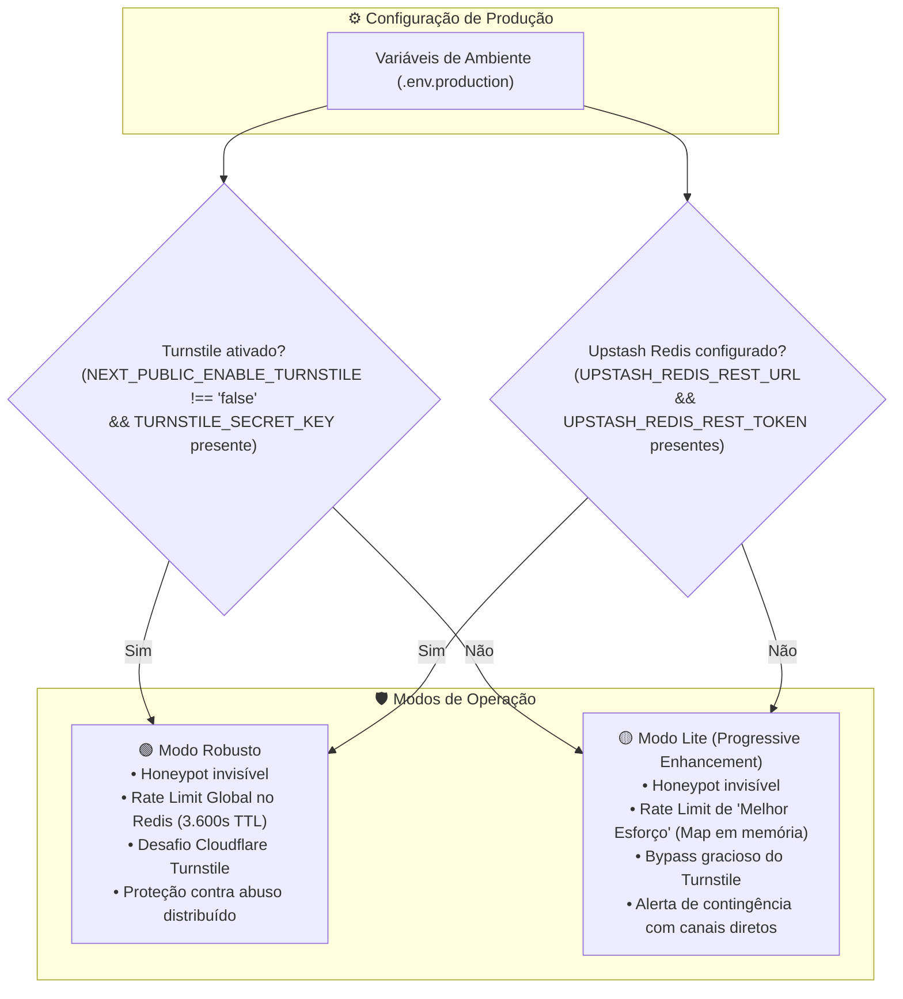

# ADR 0012: Estratégia de Deploy Progressivo (Modo Lite vs. Modo Robusto) e Rate Limiting Serverless de Melhor Esforço

* **Status:** Aceito (Emenda parcialmente os ADRs 0009 e 0011)
* **Data:** 2026-10-25
* **Decisores:** Engenharia de Software / Autor do Projeto

> Estabelece o desacoplamento de dependências externas de segurança em produção, permitindo a alternância entre o Modo Robusto (defesa integral distribuída) e o Modo Lite (deploy progressivo com rate limiting de melhor esforço).

---

## 1. Contexto (Context)

Os registros [ADR 0009](0009-seguranca-headers-e-validacao-de-ambiente.md) e [ADR 0011](0011-defesa-antispam-e-protecao-de-formularios.md) estabeleceram originalmente que a presença de credenciais do **Cloudflare Turnstile** e do **Upstash Redis** era estritamente mandatória em qualquer ambiente de produção (`NODE_ENV === "production"`).

Contudo, durante o desenvolvimento e validação prática da **Feature 003**, observou-se uma barreira de fricção operacional relevante:
1. **Atrito em Micro-Projetos e Clientes Pequenos:** Freelancers e agências frequentemente realizam entregas para clientes que inicialmente possuem apenas uma conta de hospedagem (Vercel) e de envio transacional (Resend). A exigência de criar previamente contas e configurar credenciais na Cloudflare (Turnstile) e Upstash (Redis) impedia deploys em produção de versões mínimas viáveis (*Progressive Enhancement*).
2. **Necessidade de Deploy com Dependências Parciais:** Um cliente pode optar por iniciar a operação sem Turnstile (evitando scripts de validação de terceiros) ou sem banco Redis compartilhado, aceitando um nível de proteção proporcional ao seu tráfego inicial.

Entretanto, flexibilizar essas variáveis sem formalização arquitetural traria riscos de conformidade:
* Em plataformas serverless (Vercel), instâncias de Server Actions são efêmeras e escalam horizontalmente. O armazenamento de contadores em memória RAM local (`Map`) **não é compartilhado entre containers serverless concorrentes**.
* Portanto, em produção sem Redis, a retenção de requisições por IP não é globalmente coordenada, atuando estritamente em regime de **"melhor esforço" (*best-effort*)**.

---

## 2. Decisão (Decision)

Decidimos instituir a estratégia de **Deploy Progressivo de Segurança**, dividindo a operação do formulário em dois modos formais de produção:

### 2.1. Modo Robusto (Padrão Recomendado para Escala Comercial)
* **Requisitos:** `NEXT_PUBLIC_ENABLE_TURNSTILE="true"`, chaves do Turnstile preenchidas e credenciais completas do Upstash Redis configuradas.
* **Comportamento:**
  * Camada 1: Descarte silencioso via Honeypot.
  * Camada 2: Rate Limiting atômico global no Upstash Redis (`INCR` + `EXPIRE 3600`) limitado a 5 requisições/hora por hash de IP (`HMAC-SHA256`), aplicando política *Fail-Closed* em caso de pane, erro 5xx ou timeout de conexão.
  * Camada 3: Verificação criptográfica do token na API da Cloudflare (*Fail-Closed* em caso de erro/timeout).
  * Envio: Resend API com mascaramento seguro de erros.

### 2.2. Modo Lite (Deploy Progressivo / Baixo Atrito)
* **Requisitos:** Apenas as variáveis core da aplicação (`NEXT_PUBLIC_SITE_URL`, `RESEND_API_KEY`, `RESEND_FROM_EMAIL`, `CONTACT_EMAIL_TO`, `RATE_LIMIT_SECRET`). `NEXT_PUBLIC_ENABLE_TURNSTILE="false"` ou chaves ausentes.
* **Comportamento e Compromisso de "Melhor Esforço":**
  * O formulário funciona e dispara e-mails normalmente via Resend.
  * O desafio Turnstile é omitido no frontend e ignorado de forma segura na Server Action.
  * O Rate Limiting utiliza um `Map` nativo em memória local com timestamp de expiração (TTL de 3.600 segundos). **Fica expressamente registrado que, em ambientes serverless, esse controle opera em regime de melhor esforço (*best-effort*)**, atuando eficientemente contra disparos múltiplos no mesmo container, mas sem coordenar limites globais entre múltiplas instâncias concorrentes.
  * A primeira linha de defesa contra bots automatizados passa a ser o **Honeypot invisível**, complementado pela limitação diária de 100 envios da própria Resend API e canais diretos de contingência (WhatsApp/Telefone).

### 2.3. Emenda aos ADRs Anteriores
* **[ADR 0009](0009-seguranca-headers-e-validacao-de-ambiente.md) (Seção 2.1):** A obrigatoriedade estrita das chaves do Turnstile em produção passa a ser vinculada à ativação do Modo Robusto. Em Modo Lite, o schema de ambiente permite a ausência das chaves sem abortar o build.
* **[ADR 0011](0011-defesa-antispam-e-protecao-de-formularios.md) (Seções 2.2 e 2.3):** A obrigatoriedade de armazenamento Redis em produção é flexibilizada para o Modo Lite, formalizando o regime de melhor esforço do Map em memória serverless.

---

## 3. Consequências e Trade-offs (Consequences)

### Positivas (Benefícios):
* **Onboarding Acelerado:** Permite a clientes iniciais publicarem o site em produção com configuração zero de serviços adicionais (apenas Vercel + Resend).
* **Ausência de Travamento no CI/CD:** Projetos em desenvolvimento inicial não sofrem quebra de build caso decidam não contratar ou configurar o Upstash Redis de imediato.
* **Transparência de Arquitetura:** Documenta a fronteira exata entre o que é contenção distribuída garantida e o que é mitigação de melhor esforço.

### Negativas (Riscos e Desvantagens Aceitas):
* **Taxa de Spam Potencialmente Maior no Modo Lite:** Sem o Turnstile e com rate limiting isolado por instância lambda, botnets mais sofisticadas podem consumir a cota diária do Resend mais rapidamente no Modo Lite, reforçando a importância dos alertas de consumo a 80% e 100% no Resend.
* **Dependência do Honeypot:** Em Modo Lite, a eficácia inicial repousa quase exclusivamente na eficácia do campo honeypot oculto.

---

## 4. Alternativas Consideradas

* **Manter Upstash e Turnstile Estritamente Obrigatórios (Status Quo):** Descartado por impor sobrecarga operacional excessiva a clientes de micro-porte e violar o princípio de simplicidade antes de complexidade.
* **Remover o Rate Limiting quando Ausente o Redis:** Descartado; o `Map` em memória, mesmo sendo de melhor esforço, é capaz de conter cliques rápidos acidentais e rajadas na mesma sessão serverless, sendo preferível à ausência total de controle.

