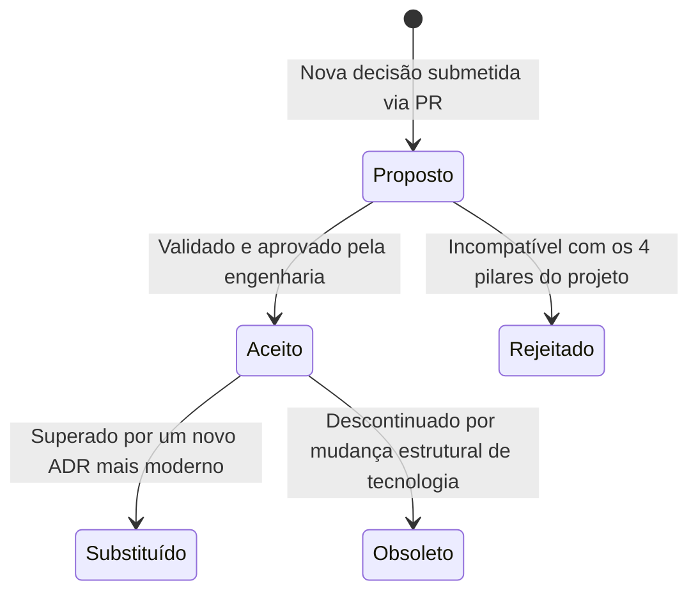

# 📌 Registros de Decisão Arquitetural (ADRs)

Este diretório centraliza os **Architectural Decision Records (ADRs)** do `institutional-website-template`. Cada ADR documenta formalmente uma decisão técnica crucial, registrando o contexto em que foi tomada, as alternativas avaliadas, as justificativas e as consequências/compromissos técnicos aceitos pela equipe.

---

## 🗂️ Índice Geral de Decisões

| ID | Título | Status | Data | Decisão Principal |
| :---: | :--- | :---: | :---: | :--- |
| **0001** | [Escolha do Framework Base - Next.js](0001-escolha-do-framework-next.md) | `Aceito` | 2026-10-20 | Adotar Next.js 16 (App Router - Active LTS) como base unificada para SSG/ISR e Server Actions nativas. |
| **0002** | [Escolha da Camada de Gestão de Conteúdo - Keystatic](0002-escolha-do-cms-keystatic.md) | `Aceito` | 2026-10-20 | Utilizar Keystatic como CMS Git-based gravando Markdown/JSON no repositório sem necessidade de banco gerenciado. |
| **0003** | [Estratégia de Formulários e Comunicação Transacional](0003-estrategia-de-formularios.md) | `Aceito` | 2026-10-20 | Empregar React Hook Form + Zod compartilhado + Server Actions e entrega transacional via Resend API. |
| **0004** | [Design System, Estilização e Acessibilidade](0004-design-system-e-estilizacao.md) | `Aceito` | 2026-10-20 | Adotar Tailwind CSS v4 (`@theme`) e Shadcn/ui com primitivos Radix UI compatíveis com WCAG 2.1 AA. |
| **0005** | [Estratégia de Hospedagem, Infraestrutura e CI/CD](0005-estrategia-de-hospedagem-e-cicd.md) | `Aceito` | 2026-10-20 | Adotar Vercel como plataforma de referência oficial do MVP e documentar Cloudflare Pages como alternativa separada. |
| **0006** | [Autenticação do CMS em Produção e Gestão de Mídia](0006-autenticacao-cms-e-gestao-de-midia.md) | `Aceito` | 2026-10-21 | Integrar Keystatic Cloud (com fallback para GitHub App próprio) para editores não técnicos e estabelecer diretrizes contra inchaço do Git. |
| **0007** | [Conformidade com a LGPD e Privacidade por Design](0007-conformidade-lgpd-e-privacidade.md) | `Aceito` | 2026-10-22 | Implementar retenção zero no banco, opt-in configurável no Zod, telemetria agregada e páginas legais fidedignas aos serviços ativos. |
| **0008** | [Qualidade Automatizada, Testes e Acessibilidade Contínua](0008-qualidade-automatizada-e-testes.md) | `Aceito` | 2026-10-22 | Estabelecer pipeline GitHub Actions CI (lint, typecheck, Vitest, vitest-axe, Lighthouse CI e Dependabot semanal). |
| **0009** | [Política de Segurança, Headers HTTP e Validação de Ambiente](0009-seguranca-headers-e-validacao-de-ambiente.md) | `Aceito*` | 2026-10-22 | Garantir validação estrita de envs com Zod no build (`src/env/`), Security Headers HTTP e política de segurança (`SECURITY.md`). *(Emendado pelo ADR 0012)* |
| **0010** | [Estratégia de Versionamento do Template e Propagação de Atualizações](0010-estrategia-de-atualizacao-e-versionamento.md) | `Aceito` | 2026-10-22 | Estabelecer SemVer/Releases e estruturar validação prática de fluxos de propagação com baixo índice de conflito. |
| **0011** | [Defesa Anti-Spam, Proteção de Formulários e Rate Limiting](0011-defesa-antispam-e-protecao-de-formularios.md) | `Aceito*` | 2026-10-22 | Implementar defesa em 3 camadas (Honeypot, Turnstile e Rate Limiting) com monitoramento e protocolo de contingência de cota. *(Emendado pelo ADR 0012)* |
| **0012** | [Estratégia de Deploy Progressivo (Modo Lite vs. Modo Robusto) e Rate Limiting Serverless de Melhor Esforço](0012-deploy-progressivo-modo-lite-e-rate-limiting-serverless.md) | `Aceito` | 2026-10-25 | Estabelecer desacoplamento de serviços externos com Modo Lite opcional e documentar Rate Limiting serverless em memória como de melhor esforço. |
| **0013** | [Arquitetura Unificada Full-Stack (App Router) vs. Separação Física Frontend/Backend](0013-arquitetura-unificada-fullstack-vs-separacao-fisica.md) | `Aceito` | 2026-10-26 | Adotar monólito modular unificado do Next.js App Router e rejeitar pastas físicas separadas `frontend/` e `backend/` em favor de segregação lógica estrita. |
| **0014** | [Rejeição de Gerenciadores de Estado Global em favor de React Server Components](0014-rejeicao-de-estado-global-em-favor-de-rsc.md) | `Aceito` | 2026-10-26 | Rejeitar bibliotecas de estado global (Redux, Zustand, Contexts em cascata) e adotar fluxo de dados Server-First via RSC e estado colocalizado na folha. |

---

## 🔄 Ciclo de Vida dos Registros

Cada decisão arquitetural deve refletir um dos seguintes estados:



* **`Proposto`:** Submetido para revisão em pull request, em fase de discussão com o time.
* **`Aceito`:** Aprovado e implementado ativamente no repositório.
* **`Rejeitado`:** Avaliado e descartado, com a justificativa técnica documentada.
* **`Substituído`:** Uma decisão anterior que foi superada por um ADR mais recente (deve apontar o link para o substituto).
* **`Obsoleto`:** Uma funcionalidade ou tecnologia que não é mais relevante para a arquitetura do projeto.

---

## 📝 Como Propor um Novo ADR

Para propor uma nova decisão de arquitetura:

1. Crie uma nova branch a partir de `main`:

   ```bash
   git checkout -b adr/novo-topico
   ```

2. Crie o arquivo numerado sequencialmente em `docs/adr/00XX-titulo-descritivo.md` seguindo o formato:

    - **Status:** Proposto
    - **Data:** AAAA-MM-DD
    - **Decisores:** Nomes ou papéis envolvidos
    - **1. Contexto:** Qual é o problema de negócio ou desafio técnico?
    - **2. Decisão:** Qual foi a escolha técnica detalhada?
    - **3. Consequências e Trade-offs:** Benefícios e custos/riscos aceitos.
    - **4. Alternativas Consideradas:** Quais tecnologias foram descartadas e por quê.

3. Atualize esta tabela índice em `docs/adr/README.md`.
4. Abra um Pull Request para revisão da equipe.
