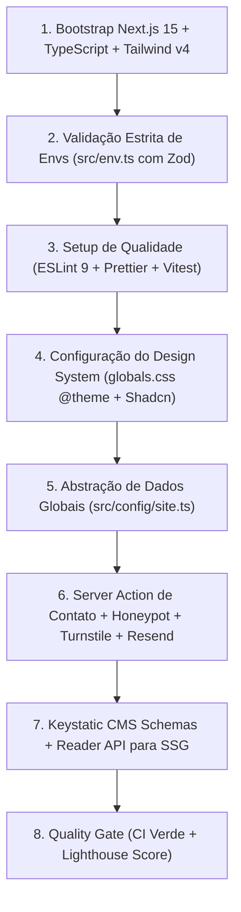

# 2026-10 Feedback Arquitetura por Antigravity

Realizei uma análise abrangente e aprofundada de todo o repositório — estrutura de arquivos, governança, decisões arquiteturais, automação e estratégias operacionais.

Abaixo está o **diagnóstico geral**, destacando os pontos fortes que colocam este template no estado da arte, os pontos de atenção críticos e as recomendações práticas para a próxima fase.

---

## 🧭 1. Diagnóstico Geral do Projeto

O projeto se encontra em um momento de transição crucial: a **Fase 1 (Fundação, Setup e Governança)** foi concluída com um nível de rigor técnico e maturidade arquitetural **raramente visto em *boilerplates* de mercado**.

A maioria dos templates comerciais foca apenas em componentes visuais bonitos, negligenciando a governança, as questões legais (LGPD), a sustentabilidade de custos e a esteira de manutenção contínua. Este projeto tomou o caminho inverso e correto: **construiu primeiro as fundações de engenharia**, criando uma blindagem completa antes de escrever a primeira linha de componente visual.

---

## 🌟 2. Principais Pontos Fortes (Diferenciais Competitivos)

### A. Governança e Rastreabilidade Excepcionais (ADRs 0001 a 0011)

- O catálogo de 11 ADRs com o índice mestre [docs/adr/README.md](file:///e:/Projects/GitHub/heviane/institutional-website-template/docs/adr/README.md) elimina a "amnésia arquitetural". Qualquer desenvolvedor que assumir o projeto saberá exatamente *por que* o Keystatic foi escolhido em vez do Strapi, *por que* o Turnstile foi preferido ao reCAPTCHA e *como* o custo de infraestrutura é mantido em $0.

### B. Proteção Financeira e Operacional do Pilar de Custo $0

- O acoplamento entre [ADR 0003](file:///e:/Projects/GitHub/heviane/institutional-website-template/docs/adr/0003-estrategia-de-formularios.md) e [ADR 0011](file:///e:/Projects/GitHub/heviane/institutional-website-template/docs/adr/0011-defesa-antispam-e-protecao-de-formularios.md) é uma das decisões mais inteligentes do projeto: blindar os formulários com **Honeypot + Turnstile + Rate Limiting por IP** impede que *spambots* esgotem a cota diária de 100 e-mails do plano gratuito do Resend. Sem isso, o template geraria incidentes comerciais constantes com clientes.

### C. Industrialização do Onboarding do Cliente

- O [docs/07-client-onboarding-checklist.md](file:///e:/Projects/GitHub/heviane/institutional-website-template/docs/07-client-onboarding-checklist.md) transforma a entrega de um website em um processo industrial previsível (< 2 horas). Detalhes como apontamentos de DNS (SPF, DKIM e DMARC) costumam ser a maior fonte de suporte e retrabalho em agências; tê-los mapeados passo a passo resolve esse gargalo na raiz.

### D. Métricas de Qualidade Objetivas e Auditáveis

- Abandonar termos genéricos como "site rápido" e adotar **critérios numéricos oficiais dos Core Web Vitals (LCP < 2,5 s, INP < 200 ms, CLS < 0,1 em Mobile)** e testes de acessibilidade automatizados com `axe-core` cria um contrato de qualidade mensurável entre a agência e o cliente final.

---

## ⚠️ 3. Pontos de Atenção e Riscos a Mitigar

Apesar do excelente planejamento, identifiquei **4 pontos de atenção** que merecem vigilância no início da implementação:

### 1. O "Abismo" da Fase 2 (Execução vs. Planejamento)

* **Situação:** A arquitetura no papel é perfeita, mas o projeto ainda não foi inicializado em código (`package.json`, `tsconfig.json`, `next.config.ts`, `src/`).
* **Risco:** Durante a codificação do Next.js 15 com Tailwind CSS v4 e React 19, podem surgir pequenas fricções de ecossistema (por exemplo, bibliotecas de terceiros que ainda não possuem suporte completo ao React 19 ou pacotes de animação).
* **Mitigação:** Manter rigor estrito na instalação de dependências, evitando pacotes obsoletos e priorizando sempre as versões LTS compatíveis com Node 22.

### 2. A Pasta `local/` no Repositório

* **Situação:** Há um diretório `local/` na raiz contendo rascunhos de markdown (`extensao-eslint.md`, `tasks.md`, etc.).
* **Risco:** Poluição do repositório público do template com notas de trabalho internas que já foram consolidadas nos documentos oficiais (`docs/01` a `07`).
* **Recomendação:** Avaliar se essa pasta deve ser excluída antes de publicar o template comercial ou adicionada ao `.gitignore` caso seja de uso exclusivo da sua máquina de desenvolvimento.

### 3. Testabilidade das Server Actions sem Disparos Reais

* **Situação:** A Server Action de contato (`src/app/actions/contact.ts`) integra três serviços externos: verificação do Turnstile (Cloudflare), envio de e-mails (Resend) e rate limiting.
* **Risco:** Se a lógica não for desacoplada em módulos injetáveis, os testes unitários do Vitest no GitHub Actions CI tentarão chamar APIs externas, falharão por falta de credenciais reais ou consumirão cotas da Resend.
* **Recomendação:** Arquitetar a Server Action isolando a camada de envio (`sendEmailService`) para permitir *mocking* trivial nos testes unitários e de integração.

### 4. Gestão de Branches e Releases do Template

* **Situação:** O [ADR 0010](file:///e:/Projects/GitHub/heviane/institutional-website-template/docs/adr/0010-estrategia-de-atualizacao-e-versionamento.md) descreve brilhantemente a estratégia de sincronização de upstream via `--allow-unrelated-histories`.
* **Recomendação:** Para facilitar o `cherry-pick` de correções críticas pelos clientes, adote no repositório do template branches ou tags de versionamento semântico (ex: `v1.0.0`, `v1.0.1`), mantendo os commits do core pequenos e atômicos.

---

## 🚀 4. Recomendações Práticas para os Próximos Passos (Fase 2)

Para iniciar a **Fase 2 (Implementação do Core & MVP)** com máxima produtividade, recomendo a seguinte ordem de execução:

1. **Executar o bootstrap do projeto** instalando as dependências do core (`next`, `react`, `react-dom`, `tailwindcss`, `zod`, `react-hook-form`, `@hookform/resolvers`, `resend`, `@keystatic/core`, `@keystatic/next`).
2. **Implementar imediatamente `src/env.ts`** para que o projeto quebre de forma segura no build caso qualquer variável obrigatória falhe.
3. **Validar a esteira do GitHub Actions (`.github/workflows/ci.yml`)** garantindo que o primeiro commit com código já execute com sucesso as etapas de lint, typecheck, teste e build.

---

### Conclusão

O projeto está em uma posição **privilegiada**. O trabalho de especificação e refinamento executado eliminou praticamente 90% das armadilhas comuns de desenvolvimento web. O repositório está pronto para receber o código do MVP com extrema confiança e velocidade.
