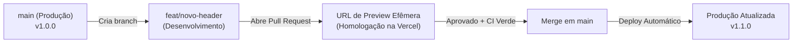

# Estratégia de Branching e Ambientes

Essa é uma excelente pergunta estratégica de engenharia de software!

A resposta curta é: **o modelo tradicional com branches fixas de `develop` e `homologação` (antigo *Git Flow*) caiu em desuso na maioria dos projetos web modernos.**

Hoje, o padrão dominante na indústria para projetos Next.js hospedados em plataformas como **Vercel** ou **Cloudflare Pages** é o **GitHub Flow** (baseado em *Trunk-Based Development* e *Preview Deployments efêmeros*).

Abaixo explico **como funciona o padrão moderno de mercado**, os motivos técnicos dessa escolha e como você deve estruturar o fluxo após o lançamento da v1.0.

---

## 🏗️ 1. Como Funciona a Prática Moderna (GitHub Flow + Previews)

Neste modelo, você **não precisa manter branches estáticas de `develop` ou `staging`**. Em vez disso, você aproveita o poder das **URLs de Preview automáticas**:



### O Ciclo de Vida:

1. **`main` é a fonte da verdade (Produção):** A branch `main` sempre reflete o código estável em produção. Ela é protegida contra *direct push* (ninguém comita direto nela).
2. **Branches curtas para desenvolvimento (`feat/*`, `fix/*`):** Para criar uma nova funcionalidade ou corrigir um bug, você cria uma branch temporária a partir de `main` (ex: `feat/faq-dinamico` ou `fix/turnstile-timeout`).
3. **Homologação via *Preview Deployments* (O grande diferencial):**
   - Assim que você abre um **Pull Request (PR)** no GitHub, a Vercel (ou Cloudflare Pages) cria automaticamente uma **URL de homologação real e isolada** (ex: `https://site-git-feat-faq-suaempresa.vercel.app`).
   - Essa URL é o seu **ambiente de homologação perfeito**: tem HTTPS, roda exatamente como produção e você pode enviar esse link para o cliente ou para a equipe testar e aprovar antes do merge!
4. **CI Obrigatório:** A esteira de CI que criamos (`ci.yml`) roda no PR para garantir que lint, testes e build passaram.
5. **Merge e Deploy Contínuo:** Quando aprovado, você faz o merge do PR para `main`. A Vercel detecta o merge e atualiza o site de produção em segundos. A branch temporária é deletada automaticamente.

---

## ⚖️ 2. Por que o modelo clássico (`develop` + `staging`) é desaconselhado hoje?

O modelo clássico (*Git Flow* com branches permanentes `develop` e `homolog`) foi criado em 2010, quando os deploys eram manuais e as empresas precisavam de servidores físicos caros dedicados para homologação.

Para templates modernos e sites institucionais, ele traz problemas sérios:

| Aspecto | Git Flow Clássico (`main` + `develop` + `staging`) | GitHub Flow Moderno (`main` + Previews) |
| :--- | :--- | :--- |
| **Ambientes de Teste** | Fixo (uma única branch de homologação que acumula features não testadas). | **Efêmero por PR:** cada funcionalidade ganha sua própria URL isolada de teste. |
| **Conflitos de Merge** | Frequentes (a branch `develop` desalinha da `main` com o tempo). | **Raros:** branches duram poucas horas ou dias e partem direto da `main`. |
| **Burocracia de Deploy** | Alta (fazer merge de feature em develop, depois develop em staging, depois staging em main). | **Baixa:** 1 PR testado e aprovado vai direto para a produção. |
| **Custo de Infraestrutura** | Pode gerar custos com múltiplos ambientes fixos rodando. | **$0:** Previews na Vercel são gratuitas e descartadas após o merge. |

---

## 🏷️ 3. Como Gerenciar as Versões Após a v1.0 (Git Tags & Releases)

Para templates que outros projetos herdam, o controle de versões é feito via **Git Tags (Versionamento Semântico)** diretamente na `main`, e não através de branches:

```bash
# Quando a v1.0.0 estiver pronta para produção:
git tag -a v1.0.0 -m "release: versao 1.0.0 do institutional-website-template"
git push origin v1.0.0
```

* **`v1.0.0` (Major):** Versão inicial completa com Core & MVP.
* **`v1.0.1` (Patch):** Correções de bugs de segurança ou pequenas dependências.
* **`v1.1.0` (Minor):** Novas funcionalidades retrocompatíveis (ex: novo componente de blog ou Dark Mode).

No GitHub, você cria uma **Release** associada à tag com o changelog. Isso permite que qualquer cliente que use o template saiba exatamente o que mudou e possa aplicar commits específicos com `git cherry-pick`.

---

## 🎯 4. Resumo e Recomendação para o seu Projeto

Assim que concluirmos o código da **Fase 2 (Core & MVP)** e lançarmos a `v1.0.0`:

1. **Ative a Proteção da branch `main` no GitHub:**
   - Acesse `Settings` > `Branches` > `Branch protection rule` para `main`.
   - Marque:
     - ✅ *Require a pull request before merging* (exige PR para qualquer alteração).
     - ✅ *Require status checks to pass before merging* (selecionando nosso workflow `ci.yml`).
2. **Para qualquer alteração futura (Fase 3 ou novos recursos):**
   - Crie uma branch: `git checkout -b feat/nome-da-feature`
   - Abra o PR no GitHub e compartilhe a **URL de Preview da Vercel** para homologação.
   - Com o CI verde e a homologação aprovada, faça o merge no botão **Squash and merge**.
3. **Crie tags de release** (`v1.0.0`, `v1.1.0`) para manter o histórico do template auditável.

Esse é o fluxo mais rápido, profissional, seguro e sem fricção adotado pelas melhores equipes de frontend do mundo hoje!
