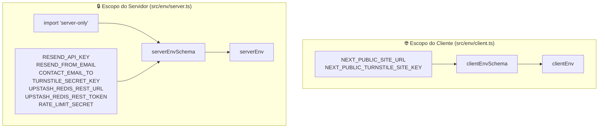
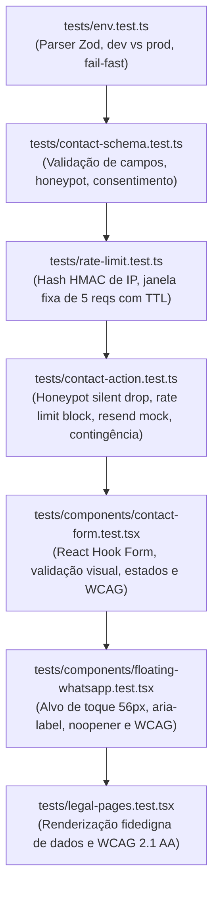

# Feature 003: Validação de Ambiente, Formulário Transacional & Conformidade Legal (Plan)

* **Status:** Concluída
* **Spec de Referência:** [`spec.md`](spec.md)
* **Constituição de Engenharia:** [`AGENTS.md`](../../AGENTS.md)
* **ADRs Vinculados:**
  * [ADR 0003: Estratégia de Formulários e Comunicação Transacional](../../docs/adr/0003-estrategia-de-formularios.md)
  * [ADR 0007: Conformidade com a LGPD e Privacidade por Design](../../docs/adr/0007-conformidade-lgpd-e-privacidade.md)
  * [ADR 0009: Política de Segurança, Headers HTTP e Validação de Ambiente](../../docs/adr/0009-seguranca-headers-e-validacao-de-ambiente.md)
  * [ADR 0011: Defesa Anti-Spam, Proteção de Formulários e Rate Limiting](../../docs/adr/0011-defesa-antispam-e-protecao-de-formularios.md)

---

## 🏗️ 1. Arquitetura Técnica e Decisões de Implementação

### 1.1. Dependências Necessárias

Para materializar o escopo da Feature 003 sem redundâncias, serão adicionadas as seguintes dependências:

* **Produção:**
  * `react-hook-form` (`^7.54.x`): Gerenciamento de formulário não-controlado com zero re-renderizações desnecessárias (INP).
  * `@hookform/resolvers` (`^3.10.x`): Integração entre React Hook Form e o Zod v3 (`^3.24.x`).
  * `resend` (`^4.1.x`): SDK oficial da Resend API para envio transacional de e-mails via HTTP serverless.
  * `@upstash/redis` (`^1.34.x`): Cliente HTTP leve para rate limiting em produção serverless com Vercel/Edge.
  * `@marsidev/react-turnstile` (`^1.1.x`): Componente leve e acessível para renderização do widget Cloudflare Turnstile.
* **Desenvolvimento / Tipagem:**
  * Já cobertos pelo projeto (`zod`, `vitest`, `axe-core`, `vitest-axe`).

---

### 1.2. Segregação Física de Variáveis de Ambiente (`src/env/`)

Conforme estabelecido no [ADR 0009](../../docs/adr/0009-seguranca-headers-e-validacao-de-ambiente.md), a validação de variáveis de ambiente deve ser fisicamente segregada para evitar vazamento acidental de segredos corporativos para o navegador:



#### Contrato de `src/env/client.ts`:
```typescript
import { z } from "zod";

export const clientEnvSchema = z
  .object({
    NODE_ENV: z.enum(["development", "test", "production"]).default("development"),
    NEXT_PUBLIC_SITE_URL: z.string().url("NEXT_PUBLIC_SITE_URL deve ser uma URL válida.").default("http://localhost:3000"),
    NEXT_PUBLIC_TURNSTILE_SITE_KEY: z.string().optional(),
    NEXT_PUBLIC_ENABLE_TURNSTILE: z
      .string()
      .optional()
      .transform((val) => val !== "false"), // Padrão true, desativável definindo como "false"
  })
  .superRefine((data, ctx) => {
    // Se Turnstile estiver ativado em produção (Modo Robusto), a chave do site é obrigatória
    if (data.NODE_ENV === "production" && data.NEXT_PUBLIC_ENABLE_TURNSTILE) {
      if (!data.NEXT_PUBLIC_TURNSTILE_SITE_KEY) {
        ctx.addIssue({
          code: z.ZodIssueCode.custom,
          path: ["NEXT_PUBLIC_TURNSTILE_SITE_KEY"],
          message: "NEXT_PUBLIC_TURNSTILE_SITE_KEY é obrigatória em produção quando o Turnstile estiver ativado.",
        });
      }
    }
  });

export const clientEnv = clientEnvSchema.parse({
  NODE_ENV: process.env.NODE_ENV,
  NEXT_PUBLIC_SITE_URL: process.env.NEXT_PUBLIC_SITE_URL,
  NEXT_PUBLIC_TURNSTILE_SITE_KEY: process.env.NEXT_PUBLIC_TURNSTILE_SITE_KEY,
  NEXT_PUBLIC_ENABLE_TURNSTILE: process.env.NEXT_PUBLIC_ENABLE_TURNSTILE,
});
```

#### Contrato de `src/env/server.ts`:
```typescript
import "server-only";
import { z } from "zod";

export const DEFAULT_DEV_RATE_LIMIT_SECRET = "template-rate-limit-dev-secret-do-not-use-in-prod";

export const serverEnvSchema = z
  .object({
    NODE_ENV: z.enum(["development", "test", "production"]).default("development"),
    RESEND_API_KEY: z.string().min(1, "RESEND_API_KEY é obrigatória."),
    RESEND_FROM_EMAIL: z.string().min(1, "RESEND_FROM_EMAIL é obrigatória."),
    CONTACT_EMAIL_TO: z.string().email("CONTACT_EMAIL_TO deve ser um e-mail válido."),
    RATE_LIMIT_SECRET: z.string().min(16, "RATE_LIMIT_SECRET deve ter no mínimo 16 caracteres.").optional(),
    TURNSTILE_SECRET_KEY: z.string().optional(),
    UPSTASH_REDIS_REST_URL: z.string().url("UPSTASH_REDIS_REST_URL deve ser uma URL válida.").optional(),
    UPSTASH_REDIS_REST_TOKEN: z.string().optional(),
  })
  .superRefine((data, ctx) => {
    // 1. Em produção, RATE_LIMIT_SECRET é estritamente obrigatório e não pode ser o valor de exemplo
    if (data.NODE_ENV === "production") {
      if (!data.RATE_LIMIT_SECRET || data.RATE_LIMIT_SECRET === DEFAULT_DEV_RATE_LIMIT_SECRET) {
        ctx.addIssue({
          code: z.ZodIssueCode.custom,
          path: ["RATE_LIMIT_SECRET"],
          message: "RATE_LIMIT_SECRET é obrigatório em produção e não pode conter o valor padrão de desenvolvimento.",
        });
      }
    }

    // 2. Paridade Estrita das Credenciais do Upstash (ambas ou nenhuma)
    const hasUpstashUrl = Boolean(data.UPSTASH_REDIS_REST_URL);
    const hasUpstashToken = Boolean(data.UPSTASH_REDIS_REST_TOKEN);

    if (hasUpstashUrl !== hasUpstashToken) {
      const missingField = hasUpstashUrl ? "UPSTASH_REDIS_REST_TOKEN" : "UPSTASH_REDIS_REST_URL";
      ctx.addIssue({
        code: z.ZodIssueCode.custom,
        path: [missingField],
        message: `${missingField} é obrigatório quando a outra credencial do Upstash Redis estiver configurada.`,
      });
    }

    // 3. Prevenção de Fail-Open no Turnstile: Se a flag estiver ativa em produção, a chave secreta é estritamente obrigatória
    const isTurnstileEnabled = process.env.NEXT_PUBLIC_ENABLE_TURNSTILE !== "false";
    if (data.NODE_ENV === "production" && isTurnstileEnabled) {
      if (!data.TURNSTILE_SECRET_KEY) {
        ctx.addIssue({
          code: z.ZodIssueCode.custom,
          path: ["TURNSTILE_SECRET_KEY"],
          message:
            "TURNSTILE_SECRET_KEY é obrigatória em produção quando o Turnstile estiver ativo. Defina NEXT_PUBLIC_ENABLE_TURNSTILE='false' para operar no Modo Lite.",
        });
      }
    }
  })
  .transform((data) => ({
    ...data,
    // Em dev/test, se RATE_LIMIT_SECRET for omitido, injeta o fallback controlado
    RATE_LIMIT_SECRET: data.RATE_LIMIT_SECRET ?? DEFAULT_DEV_RATE_LIMIT_SECRET,
  }));

export const serverEnv = serverEnvSchema.parse(process.env);
```

---

### 1.3. Schema de Contato & Dicionário Canônico (`src/lib/schemas/contact.ts`)

```typescript
import { z } from "zod";

export const contactFormSchema = z.object({
  name: z
    .string()
    .trim()
    .min(2, "O nome deve conter pelo menos 2 caracteres.")
    .max(100, "O nome deve conter no máximo 100 caracteres."),
  email: z
    .string()
    .trim()
    .toLowerCase()
    .email("Informe um endereço de e-mail corporativo ou pessoal válido.")
    .max(150, "O e-mail deve conter no máximo 150 caracteres."),
  phone: z
    .string()
    .trim()
    .max(20, "O telefone deve conter no máximo 20 caracteres.")
    .optional()
    .or(z.literal("")),
  message: z
    .string()
    .trim()
    .min(10, "A mensagem deve conter pelo menos 10 caracteres.")
    .max(1000, "A mensagem deve conter no máximo 1000 caracteres."),
  website: z
    .string()
    .max(0, "Spam detectado pelo campo honeypot.")
    .optional()
    .or(z.literal("")),
  turnstileToken: z.string().optional().or(z.literal("")),
  // Conforme ADR 0007: opt-in explícito sem consentimento presumido (.default(true) proibido por LGPD Art. 5º, XII)
  privacyConsent: z.boolean().optional(),
});

export type ContactFormData = z.infer<typeof contactFormSchema>;

export interface ActionResponse {
  success: boolean;
  message: string;
  errors?: Record<string, string[]>;
}
```

---

### 1.4. Rate Limiting com Pseudonimização de IP por Hash HMAC (`src/lib/rate-limit.ts`)

Conforme [ADR 0011](../../docs/adr/0011-defesa-antispam-e-protecao-de-formularios.md) e [ADR 0012](../../docs/adr/0012-deploy-progressivo-modo-lite-e-rate-limiting-serverless.md):
- **Cálculo da Chave:** `key = "rate-limit:" + HMAC-SHA256(ip, serverEnv.RATE_LIMIT_SECRET)` gerado via módulo nativo `node:crypto`. O endereço IP passa por pseudonimização técnica estrita (Art. 13, § 4º da LGPD) e nunca trafega nem é persistido em texto claro (privacidade por design).
- **Algoritmo Escolhido: Janela Fixa com TTL Relativo (Fixed Window with 1-hour TTL):**
  - **Trade-off Deliberado:** Prioriza simplicidade, determinismo e baixíssima sobrecarga de rede sobre a complexidade de algoritmos de janelas deslizantes (que demandariam sorted sets e múltiplas operações Redis por request). Para a mitigação de robôs de spam e preservação da cota de 100 e-mails/dia do Resend, a janela fixa de 5 envios por hora oferece proteção robusta e custo computacional mínimo.
  - **Eliminação da Data no Salt:** Ao fixar a expiração via TTL atômico de 3.600s, o registro se auto-destrói da memória/Redis após 1 hora de inatividade, eliminando a chave sem resíduos e sem a anomalia de reset artificial na virada da meia-noite (`YYYY-MM-DD`).
- **Implementação Dual e Degradação Graciosa:**
  - **Com Upstash configurado (Modo Robusto — `UPSTASH_REDIS_REST_URL` & `TOKEN`):**
    - **Execução Atômica via Script Lua (`redis.eval`):** Em ambientes serverless, chamadas separadas de `INCR` seguidas de `EXPIRE` não são atômicas e podem deixar chaves com TTL perpétuo caso a instância morra entre os dois comandos. A execução ocorre atomicamente via script Lua nativo em um único round-trip HTTP:
      ```lua
      local current = redis.call('INCR', KEYS[1])
      if current == 1 then
          redis.call('EXPIRE', KEYS[1], ARGV[1])
      end
      return current
      ```
    - Se `count > 5`, retorna `{ isAllowed: false, remaining: 0, resetAt }`.
    - Se `count <= 5`, retorna `{ isAllowed: true, remaining: 5 - count, resetAt }`.
    - **Falha de Conexão no Redis em Produção (Fail-Closed):** Se o Redis lançar exceção ou timeout em produção, a ação rejeita o envio de e-mails e orienta o usuário para canais diretos (WhatsApp/Telefone).
  - **Sem Upstash configurado (Modo Lite / dev / micro-projetos — ADR 0012):**
    - Armazena em `Map<string, { count: number; expiresAt: number }>`.
    - **Compromisso de "Melhor Esforço" (*Best-Effort*):** Em arquiteturas serverless com instâncias efêmeras, a memória RAM não é sincronizada globalmente entre containers concorrentes. O Map atua com eficiência contendo rajadas e disparos acidentais no mesmo container, mas opera formalmente sob regime de melhor esforço ([ADR 0012](../../docs/adr/0012-deploy-progressivo-modo-lite-e-rate-limiting-serverless.md)).
    - Ao consultar: se não existir ou `Date.now() > item.expiresAt`, cria/reseta com `{ count: 1, expiresAt: Date.now() + 3600000 }`.
    - Se existir e ainda válido: incrementa o contador e valida se `count <= 5`.
- **Extração Segura do IP e Prevenção de Balde Compartilhado:**
  - Priorização de cabeçalhos de borda: `cf-connecting-ip` (Cloudflare), `x-real-ip` (Vercel/Nginx) e o primeiro IP de `x-forwarded-for`.
  - **Ambiente de Desenvolvimento/Testes (`NODE_ENV !== "production"`):** Fallback para `"127.0.0.1"` para testes locais.
  - **Ambiente de Produção (`NODE_ENV === "production"`):** Se NENHUM cabeçalho de IP estiver presente, a Server Action **NÃO** agrupa a requisição no balde comum `"127.0.0.1"` (o que permitiria a um bot sem cabeçalho esgotar a cota de todos os demais usuários). Em vez disso, aplica o **Fail-Closed Defensivo**, rejeitando a requisição antes de acionar o Redis ou o Resend (`{ success: false, message: "Não foi possível validar a segurança da conexão. Por favor, utilize nossos canais diretos de WhatsApp ou telefone." }`).

---

### 1.5. Server Action Canônica (`src/app/actions/contact.ts`)

A Server Action cumpre o papel de fronteira segura e efêmera de dados (*Zero-Database Architecture*), aplicando rigorosamente a política **Fail-Closed** nas defesas e sanitização absoluta nas respostas:

1. **Barreira Estrutural de Payload (Infraestrutura & CPU):**
   - **Camada de Infraestrutura (`next.config.ts`):** `experimental.serverActions.bodySizeLimit = "64kb"` configurado no Next.js para descartar buffers HTTP excessivos na borda antes de alocar memória na instância serverless.
   - **Camada de CPU (Server Action):** Constante `MAX_RAW_PAYLOAD_SIZE = 5120` (~5 KB). Rejeição sumária se o payload bruto não for um objeto ou se sua representação serializada exceder 5.000 caracteres, bloqueando ataques de *Buffer Stuffing* antes de consumir ciclos de CPU com parsers complexos: `{ success: false, message: "Payload excede o limite máximo permitido." }`.
2. **Validação Funcional via Zod:** Extrai IP dos headers confiáveis e executa `contactFormSchema.safeParse(rawInput)` (validando os limites funcionais de cada campo, incluindo `message` entre 10 e 1.000 caracteres).
3. **Camada 1 (Honeypot):** Se `data.website` contiver qualquer valor, retorna silenciosamente `{ success: true, message: "Mensagem enviada com sucesso!" }` sem acionar provedores externos.
4. **Camada 2 (Rate Limit - Fail-Closed):** Verifica taxa de envio do hash de IP. Se exceder 5 envios na janela de 1 hora OU se a conexão com o Upstash Redis falhar em produção (timeout/5xx), a requisição é bloqueada imediatamente (*Fail-Closed*, não chama o Resend), retornando `{ success: false, message: "Limite temporário de envios atingido ou serviço indisponível. Por favor, entre em contato diretamente pelo nosso WhatsApp." }`.
5. **Camada 3 (Turnstile - Fail-Closed):** Se `clientEnv.NEXT_PUBLIC_ENABLE_TURNSTILE` for ativo e `serverEnv.TURNSTILE_SECRET_KEY` estiver configurada:
   - Se o token for ausente, forjado ou se a chamada à API da Cloudflare falhar (erro 5xx ou timeout de rede), a requisição é bloqueada (*Fail-Closed*, não chama o Resend), retornando `{ success: false, message: "Falha na validação de segurança. Por favor, tente novamente ou fale conosco diretamente pelo WhatsApp." }`.
   - Se em modo Lite (desativado ou chaves omitidas), o desafio é ignorado de forma segura.
6. **Disparo Transacional (Resend):** Aciona `resend.emails.send(...)` enviando de `RESEND_FROM_EMAIL` para `CONTACT_EMAIL_TO` somente se todas as camadas anteriores forem 100% aprovadas.
7. **Contingência com Sanitização Absoluta:** Se a chamada ao Resend falhar (ex.: erro 429, cota diária esgotada ou erro 5xx), captura o erro, registra log interno estruturado (`console.error("[CONTACT_ACTION_ERROR]", ...)`), mas retorna para o frontend uma resposta totalmente sanitizada:
   `{ success: false, message: "Ocorreu uma instabilidade temporária no serviço de e-mail. Por favor, utilize nossos canais diretos de WhatsApp ou telefone." }`.
   Nenhum detalhe interno, stack trace, status HTTP ou resposta crua de provedor é exposta.

---

### 1.6. Componente de Formulário Acessível (`src/components/shared/contact-form/contact-form.tsx`)

* Componente interativo `'use client'`.
* Integração com React Hook Form e `zodResolver(contactFormSchema)`.
* Alvos de toque com área mínima de **44 × 44 pixels** em todos os botões e campos interativos.
* Campo honeypot oculto via classes utilitárias acessíveis:
  ```tsx
  <div className="absolute left-[-9999px] opacity-0 pointer-events-none" aria-hidden="true">
    <input tabIndex={-1} autoComplete="off" {...register("website")} />
  </div>
  ```
* Widget do Cloudflare Turnstile com auto-reset após envio.
* Estados visuais:
  - Botão de envio com ícone de spinner e texto `"Enviando mensagem..."` em estado de submissão.
  - Alerta de sucesso semântico verde com confirmação clara de envio.
  - Alerta de erro com link rápido para atendimento direto via WhatsApp caso a Server Action aponte contingência.

---

### 1.7. Páginas Legais Estáticas (`src/app/(legal)/`)

* `src/app/(legal)/politica-de-privacidade/page.tsx`:
  - Consome dinamicamente `siteConfig.legal.companyName`, `siteConfig.legal.cnpj`, `siteConfig.legal.dpoEmail` e canais de contato.
  - **Serviços de Infraestrutura Sempre Declarados:**
    - Vercel Inc. (hospedagem serverless e roteamento de borda).
    - Resend Inc. / AWS (encaminhamento efêmero de e-mails para a caixa corporativa, sem armazenamento de mensagens em banco de dados).
    - Upstash Inc. (armazenamento temporário de hash pseudonimizado de IP via HMAC com auto-expiração atômica de 1 hora para contenção de abusos no Modo Robusto).
  - **Cláusula de Transferência Internacional de Dados (Art. 33 da LGPD):**
    - Declaração transparente informando que os servidores de nuvem dos parceiros tecnológicos (Vercel, AWS/Resend, Cloudflare) residem em território internacional, operando sob salvaguardas contratuais e criptografia de ponta a ponta (TLS 1.3).
  - **Renderização Condicional por Configuração (Fidelidade aos Serviços Ativos - ADR 0007):**
    - Cloudflare Turnstile: renderizado apenas se `siteConfig.legal.services?.turnstile !== false` e `clientEnv.NEXT_PUBLIC_ENABLE_TURNSTILE !== false`.
    - Plausible Analytics: renderizado apenas se `siteConfig.legal.services?.plausible === true` (na Feature 003, o valor padrão é `false` e a ferramenta **não é mencionada**, sendo ativada apenas na Feature 005).
    - Google Analytics / Pixels: renderizado apenas se `siteConfig.legal.services?.googleAnalytics === true`.
* `src/app/(legal)/termos-de-uso/page.tsx`:
  - Termos padrão de uso do website institucional com base nas leis brasileiras e dados da empresa.
* Ambas páginas contam com container de leitura otimizado (`max-w-4xl mx-auto py-16 md:py-24 px-4 sm:px-6 lg:px-8`) e conformidade WCAG 2.1 AA.

---

### 1.8. Botão Flutuante de WhatsApp (`src/components/shared/floating-whatsapp/`)

* Componente de ação flutuante (`FloatingWhatsApp`) renderizado globalmente em `src/app/layout.tsx`:
  - Visibilidade condicionada a `siteConfig.contact.showFloatingWhatsapp !== false`.
  - Posicionamento fixo `fixed bottom-6 right-6 z-50` com alvo de toque amplo de 56x56px (acima dos 44x44px mínimos exigidos pela WCAG 2.1 AA).
  - Ícone vetorial do WhatsApp (SVG inline otimizado sem dependências extras), fundo verde oficial (`#25D366`), transições suaves e sombra projetada (`shadow-lg hover:shadow-xl`).
  - Navegação segura e acessível: link externo com `target="_blank"`, `rel="noopener noreferrer"`, `aria-label="Falar conosco no WhatsApp"` e anel de foco visível por teclado (`focus-visible:ring-2 focus-visible:ring-offset-2`).

---

### 1.9. Homologação & Smoke Test em Nuvem (Vercel Preview)

Após a aprovação local de todos os Quality Gates (`npm run verify`), o template é elegível para um **deploy piloto de sanidade** em ambiente serverless da Vercel:
- **Objetivo:** Antecipar a validação em nuvem do runtime Next.js 16 com Turbopack, Tailwind CSS v4, headers de segurança e disparo real da Resend API antes de iniciar o desenvolvimento do Keystatic CMS (Feature 004).
- **Ambiente:** Projeto de teste/preview na Vercel com subdomínio temporário (`.vercel.app`) configurando apenas as variáveis core mínimas (`NEXT_PUBLIC_SITE_URL`, `RESEND_API_KEY`, `RESEND_FROM_EMAIL`, `CONTACT_EMAIL_TO`).

---

## 🧪 2. Estratégia de Testes Automatizados (TDD)



---

## 📁 3. Estrutura de Arquivos a Ser Gerada

```text
institutional-website-template/
├── src/
│   ├── env/
│   │   ├── client.ts                # Schema e clientEnv público (NEXT_PUBLIC_*)
│   │   └── server.ts                # Schema e serverEnv protegido (import "server-only")
│   ├── lib/
│   │   ├── schemas/
│   │   │   └── contact.ts           # Schema Zod do formulário e opt-in LGPD
│   │   ├── rate-limit.ts            # Rate limiting anônimo com hash HMAC de IP
│   │   └── resend.ts                # Instância do cliente Resend
│   ├── app/
│   │   ├── layout.tsx               # Inclusão global do FloatingWhatsApp
│   │   ├── actions/
│   │   │   └── contact.ts           # Server Action canônica de contato com 3 camadas
│   │   ├── (legal)/
│   │   │   ├── politica-de-privacidade/
│   │   │   │   └── page.tsx         # Política de Privacidade transparente
│   │   │   └── termos-de-uso/
│   │   │       └── page.tsx         # Termos de Uso institucionais
│   │   └── page.tsx                 # Atualização da Home integrando o formulário real
│   └── components/
│       └── shared/
│           ├── contact-form/
│           │   └── contact-form.tsx # Componente do formulário de contato acessível
│           └── floating-whatsapp/
│               └── floating-whatsapp.tsx # Botão flutuante de WhatsApp com WCAG 2.1 AA
└── tests/
    ├── env.test.ts                  # Testes da camada de validação de ambiente
    ├── contact-schema.test.ts       # Testes unitários do schema Zod de contato
    ├── rate-limit.test.ts           # Testes do algoritmo de rate limiting e hash HMAC
    ├── contact-action.test.ts       # Testes de integração da Server Action com mocks
    ├── legal-pages.test.tsx         # Testes de renderização e acessibilidade das páginas legais
    └── components/
        ├── contact-form.test.tsx    # Testes do componente de formulário com axe
        └── floating-whatsapp.test.tsx # Testes do botão flutuante com axe
```

