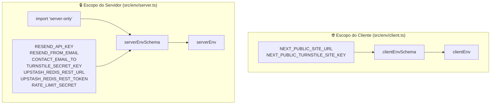
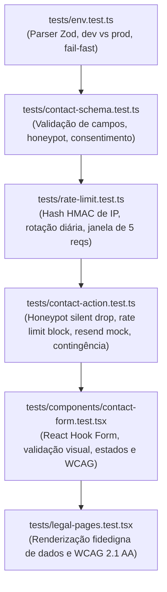

# Feature 003: Validação de Ambiente, Formulário Transacional & Conformidade Legal (Plan)

* **Status:** Em Especificação (Aguardando Aprovação do Desenvolvedor)
* **Spec de Referência:** [`spec.md`](spec.md)
* **Constituição de Engenharia:** [`AGENTS.md`](../../AGENTS.md)
* **ADRs Vinculados:**
  * [ADR 0003: Estratégia de Formulários e Comunicação Transacional](../../docs/adr/0003-estrategia-de-formularios.md)
  * [ADR 0007: Conformidade com a LGPD e Privacidade por Design](../../docs/adr/0007-conformidade-lgpd-e-privacidade.md)
  * [ADR 0009: Política de Segurança, Headers HTTP e Validação de Ambiente](../../docs/adr/0009-seguranca-headers-e-validacao-de-ambiente.md)
  * [ADR 0011: Defesa Anti-Spam, Proteção de Formulários e Rate Limiting](../../docs/adr/0011-defesa-antispam-e-protecao-de-formularios.md)

---

## 🏗️ 1. Arquitetura Técnica e Decisões de Implementação

### 1.1. Dependências Necessárias

Para materializar o escopo da Feature 003 sem redundâncias, serão adicionadas as seguintes dependências:

* **Produção:**
  * `react-hook-form` (`^7.54.x`): Gerenciamento de formulário não-controlado com zero re-renderizações desnecessárias (INP).
  * `@hookform/resolvers` (`^3.10.x`): Integração entre React Hook Form e o Zod v3 (`^3.24.x`).
  * `resend` (`^4.1.x`): SDK oficial da Resend API para envio transacional de e-mails via HTTP serverless.
  * `@upstash/redis` (`^1.34.x`): Cliente HTTP leve para rate limiting em produção serverless com Vercel/Edge.
  * `@marsidev/react-turnstile` (`^1.1.x`): Componente leve e acessível para renderização do widget Cloudflare Turnstile.
* **Desenvolvimento / Tipagem:**
  * Já cobertos pelo projeto (`zod`, `vitest`, `axe-core`, `vitest-axe`).

---

### 1.2. Segregação Física de Variáveis de Ambiente (`src/env/`)

Conforme estabelecido no [ADR 0009](../../docs/adr/0009-seguranca-headers-e-validacao-de-ambiente.md), a validação de variáveis de ambiente deve ser fisicamente segregada para evitar vazamento acidental de segredos corporativos para o navegador:



#### Contrato de `src/env/client.ts`:
```typescript
import { z } from "zod";

export const clientEnvSchema = z.object({
  NEXT_PUBLIC_SITE_URL: z.string().url("NEXT_PUBLIC_SITE_URL deve ser uma URL válida.").default("http://localhost:3000"),
  NEXT_PUBLIC_TURNSTILE_SITE_KEY: z.string().optional(),
  NEXT_PUBLIC_ENABLE_TURNSTILE: z
    .string()
    .optional()
    .transform((val) => val !== "false"), // Padrão true, desativável definindo como "false"
});

export const clientEnv = clientEnvSchema.parse({
  NEXT_PUBLIC_SITE_URL: process.env.NEXT_PUBLIC_SITE_URL,
  NEXT_PUBLIC_TURNSTILE_SITE_KEY: process.env.NEXT_PUBLIC_TURNSTILE_SITE_KEY,
  NEXT_PUBLIC_ENABLE_TURNSTILE: process.env.NEXT_PUBLIC_ENABLE_TURNSTILE,
});
```

#### Contrato de `src/env/server.ts`:
```typescript
import "server-only";
import { z } from "zod";

export const serverEnvSchema = z.object({
  NODE_ENV: z.enum(["development", "test", "production"]).default("development"),
  RESEND_API_KEY: z.string().min(1, "RESEND_API_KEY é obrigatória."),
  RESEND_FROM_EMAIL: z.string().min(1, "RESEND_FROM_EMAIL é obrigatória."),
  CONTACT_EMAIL_TO: z.string().email("CONTACT_EMAIL_TO deve ser um e-mail válido."),
  RATE_LIMIT_SECRET: z.string().min(16, "RATE_LIMIT_SECRET deve ter no mínimo 16 caracteres.").default("template-rate-limit-default-secret"),
  TURNSTILE_SECRET_KEY: z.string().optional(),
  UPSTASH_REDIS_REST_URL: z.string().url().optional(),
  UPSTASH_REDIS_REST_TOKEN: z.string().optional(),
}).superRefine((data, ctx) => {
  // Se UPSTASH_REDIS_REST_URL for configurado, UPSTASH_REDIS_REST_TOKEN passa a ser obrigatório
  if (data.UPSTASH_REDIS_REST_URL && !data.UPSTASH_REDIS_REST_TOKEN) {
    ctx.addIssue({
      code: z.ZodIssueCode.custom,
      path: ["UPSTASH_REDIS_REST_TOKEN"],
      message: "UPSTASH_REDIS_REST_TOKEN é obrigatório quando UPSTASH_REDIS_REST_URL estiver configurado.",
    });
  }
});
```

---

### 1.3. Schema de Contato & Dicionário Canônico (`src/lib/schemas/contact.ts`)

```typescript
import { z } from "zod";

export const contactFormSchema = z.object({
  name: z
    .string()
    .min(2, "O nome deve conter pelo menos 2 caracteres.")
    .max(100, "O nome deve conter no máximo 100 caracteres.")
    .trim(),
  email: z
    .string()
    .email("Informe um endereço de e-mail corporativo ou pessoal válido.")
    .max(150, "O e-mail deve conter no máximo 150 caracteres.")
    .toLowerCase()
    .trim(),
  phone: z
    .string()
    .max(20, "O telefone deve conter no máximo 20 caracteres.")
    .optional()
    .or(z.literal("")),
  message: z
    .string()
    .min(10, "A mensagem deve conter pelo menos 10 caracteres.")
    .max(1000, "A mensagem deve conter no máximo 1000 caracteres.")
    .trim(),
  website: z
    .string()
    .max(0, "Spam detectado pelo campo honeypot.")
    .optional()
    .or(z.literal("")),
  turnstileToken: z.string().optional().or(z.literal("")),
  privacyConsent: z.boolean().default(true),
});

export type ContactFormData = z.infer<typeof contactFormSchema>;

export interface ActionResponse {
  success: boolean;
  message: string;
  errors?: Record<string, string[]>;
}
```

---

### 1.4. Rate Limiting com Hash Anônimo de IP (`src/lib/rate-limit.ts`)

Conforme [ADR 0011](../../docs/adr/0011-defesa-antispam-e-protecao-de-formularios.md):
- **Cálculo da Chave:** `HMAC-SHA256(ip, secret + YYYY-MM-DD)` gerado via módulo nativo `node:crypto`.
- **Janela e Limite:** Padrão de 5 requisições por hora por chave.
- **Armazenamento e Degradação Graciosa:**
  - **Com Upstash configurado (`UPSTASH_REDIS_REST_URL` & `TOKEN`):** Armazenamento distribuído via `@upstash/redis` com expiração atômica de 3600 segundos (1 hora), ideal para tráfego em arquitetura serverless.
  - **Sem Upstash configurado (modo micro-projeto, dev ou fallback):** Armazenamento em memória (`Map<string, { count: number; expiresAt: number }>`) com limpeza periódica por TTL.
- **Extração Segura do IP:** Priorização de cabeçalhos de borda da Vercel (`x-real-ip`) e Cloudflare (`cf-connecting-ip`), evitando forjamento via `x-forwarded-for` direto.

---

### 1.5. Server Action Canônica (`src/app/actions/contact.ts`)

A Server Action cumpre o papel de fronteira segura e efêmera de dados (*Zero-Database Architecture*):

1. **Validação Preliminar:** Extrai IP e executa `contactFormSchema.safeParse(rawInput)`.
2. **Camada 1 (Honeypot):** Se `data.website` contiver qualquer valor, retorna silenciosamente `{ success: true, message: "Mensagem enviada com sucesso!" }` sem acionar provedores externos.
3. **Camada 2 (Rate Limit):** Verifica taxa de envio do hash de IP (via Redis ou Map local). Se excedido, retorna `{ success: false, message: "Limite temporário de envios atingido. Por favor, tente novamente mais tarde ou use nosso WhatsApp." }`.
4. **Camada 3 (Turnstile):** Se `TURNSTILE_SECRET_KEY` estiver configurada no servidor, valida o token via POST em `https://challenges.cloudflare.com/turnstile/v0/siteverify`. Se inválido ou ausente, rejeita com erro amigável. Se a chave não estiver configurada no ambiente (modo micro-projeto ou dev), o desafio é ignorado de forma transparente.
5. **Disparo Transacional (Resend):** Aciona `resend.emails.send(...)` enviando de `RESEND_FROM_EMAIL` para `CONTACT_EMAIL_TO` com assunto informativo e layout claro contendo nome, e-mail, telefone e mensagem.
6. **Contingência Graciosa:** Se a chamada ao Resend falhar (ex.: erro 429 ou esgotamento de cota), captura o erro, registra log interno e retorna mensagem amigável convidando o usuário a falar diretamente pelo WhatsApp corporativo (`siteConfig.contact.whatsapp`).

---

### 1.6. Componente de Formulário Acessível (`src/components/shared/contact-form/contact-form.tsx`)

* Componente interativo `'use client'`.
* Integração com React Hook Form e `zodResolver(contactFormSchema)`.
* Alvos de toque com área mínima de **44 × 44 pixels** em todos os botões e campos interativos.
* Campo honeypot oculto via classes utilitárias acessíveis:
  ```tsx
  <div className="absolute left-[-9999px] opacity-0 pointer-events-none" aria-hidden="true">
    <input tabIndex={-1} autoComplete="off" {...register("website")} />
  </div>
  ```
* Widget do Cloudflare Turnstile com auto-reset após envio.
* Estados visuais:
  - Botão de envio com ícone de spinner e texto `"Enviando mensagem..."` em estado de submissão.
  - Alerta de sucesso semântico verde com confirmação clara de envio.
  - Alerta de erro com link rápido para atendimento direto via WhatsApp caso a Server Action aponte contingência.

---

### 1.7. Páginas Legais Estáticas (`src/app/(legal)/`)

* `src/app/(legal)/politica-de-privacidade/page.tsx`:
  - Consome dinamicamente `siteConfig.legal.companyName`, `siteConfig.legal.cnpj`, `siteConfig.legal.dpoEmail` e canais de contato.
  - Descreve com exatidão a arquitetura de dados sem banco (*Zero-Database*), encaminhamento direto via Resend e uso do Cloudflare Turnstile com finalidade exclusiva de segurança.
* `src/app/(legal)/termos-de-uso/page.tsx`:
  - Termos padrão de uso do website institucional com base nas leis brasileiras e dados da empresa.
* Ambas páginas contam com container de leitura otimizado (`max-w-4xl mx-auto py-16 md:py-24 px-4 sm:px-6 lg:px-8`) e conformidade WCAG 2.1 AA.

---

### 1.8. Homologação & Smoke Test em Nuvem (Vercel Preview)

Após a aprovação local de todos os Quality Gates (`npm run verify`), o template é elegível para um **deploy piloto de sanidade** em ambiente serverless da Vercel:
- **Objetivo:** Antecipar a validação em nuvem do runtime Next.js 16 com Turbopack, Tailwind CSS v4, headers de segurança e disparo real da Resend API antes de iniciar o desenvolvimento do Keystatic CMS (Feature 004).
- **Ambiente:** Projeto de teste/preview na Vercel com subdomínio temporário (`.vercel.app`) configurando apenas as variáveis core mínimas (`NEXT_PUBLIC_SITE_URL`, `RESEND_API_KEY`, `RESEND_FROM_EMAIL`, `CONTACT_EMAIL_TO`).

---

## 🧪 2. Estratégia de Testes Automatizados (TDD)



---

## 📁 3. Estrutura de Arquivos a Ser Gerada

```text
institutional-website-template/
├── src/
│   ├── env/
│   │   ├── client.ts                # Schema e clientEnv público (NEXT_PUBLIC_*)
│   │   └── server.ts                # Schema e serverEnv protegido (import "server-only")
│   ├── lib/
│   │   ├── schemas/
│   │   │   └── contact.ts           # Schema Zod do formulário e opt-in LGPD
│   │   ├── rate-limit.ts            # Rate limiting anônimo com hash HMAC de IP
│   │   └── resend.ts                # Instância do cliente Resend
│   ├── app/
│   │   ├── actions/
│   │   │   └── contact.ts           # Server Action canônica de contato com 3 camadas
│   │   ├── (legal)/
│   │   │   ├── politica-de-privacidade/
│   │   │   │   └── page.tsx         # Política de Privacidade transparente
│   │   │   └── termos-de-uso/
│   │   │       └── page.tsx         # Termos de Uso institucionais
│   │   └── page.tsx                 # Atualização da Home integrando o formulário real
│   └── components/
│       └── shared/
│           └── contact-form/
│               └── contact-form.tsx # Componente do formulário de contato acessível
└── tests/
    ├── env.test.ts                  # Testes da camada de validação de ambiente
    ├── contact-schema.test.ts       # Testes unitários do schema Zod de contato
    ├── rate-limit.test.ts           # Testes do algoritmo de rate limiting e hash HMAC
    ├── contact-action.test.ts       # Testes de integração da Server Action com mocks
    ├── legal-pages.test.tsx         # Testes de renderização e acessibilidade das páginas legais
    └── components/
        └── contact-form.test.tsx    # Testes do componente de formulário com axe
```

