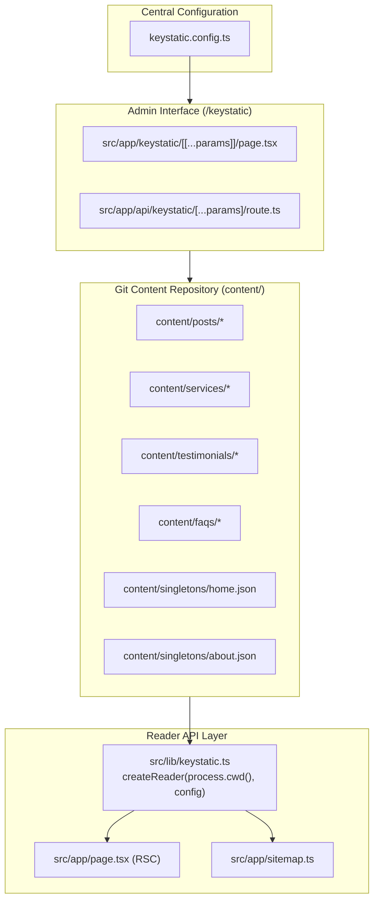

# Feature 004: Gestão de Conteúdo Baseada em Git (Keystatic CMS) — Plano Técnico

* **Data de Criação:** 2026-10-26
* **Status:** Aprovada (Pronta para Execução)
* **Spec de Referência:** [`spec.md`](spec.md)
* **Documento Canônico:** [`docs/05-keystatic-content-model.md`](../../docs/05-keystatic-content-model.md)

---

## 🏗️ 1. Arquitetura de Componentes & Rotas



---

## ⚙️ 2. Especificação do `keystatic.config.ts`

```typescript
import { config, fields, collection, singleton } from "@keystatic/core";

export default config({
  storage:
    process.env.NODE_ENV === "production" && process.env.NEXT_PUBLIC_KEYSTATIC_PROJECT
      ? {
          kind: "cloud",
        }
      : {
          kind: "local",
        },
  cloud: {
    project: process.env.NEXT_PUBLIC_KEYSTATIC_PROJECT,
  },
  collections: {
    posts: collection({
      label: "Artigos do Blog",
      slugField: "title",
      path: "content/posts/*/",
      entryLayout: "content",
      format: { contentField: "content" },
      schema: {
        title: fields.text({ label: "Título da Postagem", validation: { isRequired: true } }),
        status: fields.select({
          label: "Status de Publicação",
          options: [
            { label: "Publicado", value: "published" },
            { label: "Rascunho", value: "draft" },
          ],
          defaultValue: "draft",
        }),
        publishedDate: fields.date({
          label: "Data de Publicação",
          defaultValue: { kind: "today" },
          validation: { isRequired: true },
        }),
        summary: fields.text({
          label: "Resumo (Meta Description)",
          multiline: true,
          validation: { isRequired: true },
        }),
        coverImage: fields.image({
          label: "Imagem de Capa",
          directory: "public/images/content/posts",
          publicPath: "/images/content/posts",
        }),
        author: fields.text({ label: "Nome do Autor" }),
        content: fields.markdoc({
          label: "Conteúdo do Artigo",
          options: {
            heading: [2, 3, 4],
            blockquote: true,
            table: true,
            link: true,
          },
        }),
      },
    }),
    services: collection({
      label: "Serviços Oferecidos",
      slugField: "title",
      path: "content/services/*",
      format: "json",
      schema: {
        title: fields.text({ label: "Nome do Serviço", validation: { isRequired: true } }),
        icon: fields.text({
          label: "Ícone Lucide",
          description: "Nome do ícone da biblioteca Lucide (ex.: Briefcase, ShieldCheck, TrendingUp)",
          validation: { isRequired: true },
        }),
        shortDescription: fields.text({
          label: "Descrição Sucinta",
          multiline: true,
          validation: { isRequired: true },
        }),
        features: fields.array(fields.text({ label: "Benefício / Diferencial" }), {
          label: "Diferenciais do Serviço",
          itemLabel: (props) => props.value,
        }),
      },
    }),
    testimonials: collection({
      label: "Depoimentos de Clientes",
      slugField: "clientName",
      path: "content/testimonials/*",
      format: "json",
      schema: {
        clientName: fields.text({ label: "Nome do Cliente", validation: { isRequired: true } }),
        companyOrRole: fields.text({ label: "Empresa ou Cargo" }),
        avatar: fields.image({
          label: "Foto de Perfil",
          directory: "public/images/content/testimonials",
          publicPath: "/images/content/testimonials",
        }),
        quote: fields.text({ label: "Depoimento", multiline: true, validation: { isRequired: true } }),
        rating: fields.integer({
          label: "Avaliação (Estrelas de 1 a 5)",
          defaultValue: 5,
          validation: { min: 1, max: 5 },
        }),
      },
    }),
    faqs: collection({
      label: "Perguntas Frequentes (FAQs)",
      slugField: "question",
      path: "content/faqs/*",
      format: "json",
      schema: {
        question: fields.text({ label: "Pergunta", validation: { isRequired: true } }),
        answer: fields.markdoc({ label: "Resposta" }),
        order: fields.integer({ label: "Ordem de Exibição", defaultValue: 1 }),
      },
    }),
  },
  singletons: {
    homePage: singleton({
      label: "Página Inicial (Home)",
      path: "content/singletons/home",
      format: "json",
      schema: {
        heroHeadline: fields.text({ label: "Título de Impacto (Headline)", validation: { isRequired: true } }),
        heroSubheadline: fields.text({
          label: "Subtítulo da Proposta de Valor",
          multiline: true,
          validation: { isRequired: true },
        }),
        primaryCtaLabel: fields.text({ label: "Rótulo do Botão Principal", validation: { isRequired: true } }),
        primaryCtaLink: fields.text({ label: "Destino do Botão Principal", validation: { isRequired: true } }),
        showTestimonials: fields.checkbox({ label: "Exibir Seção de Depoimentos", defaultValue: true }),
      },
    }),
    aboutPage: singleton({
      label: "Página Sobre a Empresa",
      path: "content/singletons/about",
      format: "json",
      schema: {
        mission: fields.text({ label: "Missão", multiline: true, validation: { isRequired: true } }),
        vision: fields.text({ label: "Visão", multiline: true, validation: { isRequired: true } }),
        values: fields.array(fields.text({ label: "Valor" }), {
          label: "Valores Centrais",
          itemLabel: (props) => props.value,
        }),
        story: fields.markdoc({ label: "Nossa História / Trajetória" }),
      },
    }),
  },
});
```

---

## 📄 3. Contrato da Reader API (`src/lib/keystatic.ts`)

```typescript
import { createReader } from "@keystatic/core/reader";
import keystaticConfig from "@/../keystatic.config";

export const reader = createReader(process.cwd(), keystaticConfig);

/**
 * Returns all published blog posts, filtering out drafts.
 */
export async function getPublishedPosts() {
  const allPosts = await reader.collections.posts.all();
  return allPosts
    .filter((post) => post.entry.status === "published")
    .sort((a, b) => new Date(b.entry.publishedDate).getTime() - new Date(a.entry.publishedDate).getTime());
}

/**
 * Returns all active services ordered alphabetically or as defined.
 */
export async function getServices() {
  return reader.collections.services.all();
}

/**
 * Returns FAQs sorted by display order.
 */
export async function getFaqs() {
  const faqs = await reader.collections.faqs.all();
  return faqs.sort((a, b) => (a.entry.order ?? 0) - (b.entry.order ?? 0));
}
```

---

## 📁 4. Estrutura do *Seed Data* Inicial

Os seguintes arquivos devem ser criados e mantidos no Git:

* `content/singletons/home.json`: Conteúdo padrão do banner hero e configurações da home.
* `content/singletons/about.json`: Missão, visão e valores corporativos padrão.
* `content/services/consultoria-estrategica.json`: Serviço modelo 1.
* `content/services/seguranca-e-conformidade.json`: Serviço modelo 2.
* `content/services/transformacao-e-escala.json`: Serviço modelo 3.
* `content/faqs/quais-servicos-oferecem.json`: FAQ modelo 1.
* `content/faqs/como-funciona-o-atendimento.json`: FAQ modelo 2.
* `content/faqs/quais-sao-os-prazos.json`: FAQ modelo 3.
* `content/posts/bem-vindo-ao-novo-site/index.mdoc`: Artigo de blog publicado.
* `content/posts/governanca-e-seguranca-digital/index.mdoc`: Artigo de blog em rascunho (`status: draft`) para validação do filtro.

---

## 🧪 5. Estratégia de Testes Automatizados (Vitest)

1. `tests/keystatic-reader.test.ts`:

   - Validação da inicialização do `reader`.
   - Leitura do singleton `homePage` e asserção de schema.
   - Leitura da coleção `services` e checagem de integridade dos 3 itens semeados.
   - Leitura da coleção `faqs` e validação da ordenação numérica por `order`.
   - Teste unitário da função `getPublishedPosts()`: comprova que posts com `status: 'draft'` são excluídos do resultado público e que posts `published` são ordenados por data decrescente.

2. `tests/keystatic-routes.test.ts`:

   - Validação das rotas `/keystatic` e `/api/keystatic` quanto à exportação e isolamento de layout.
