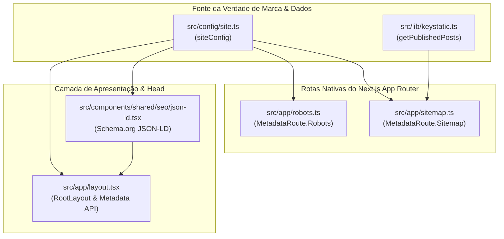

# Feature 005: SEO Técnico Avançado & Homologação MVP — Plano Técnico

- **Data de Criação:** 2026-10-26
- **Status:** Concluída
- **Spec de Referência:** [`spec.md`](spec.md)
- **Documentos Canônicos:** [`docs/01-architecture-overview.md`](../../docs/01-architecture-overview.md), [`docs/03-project-roadmap.md`](../../docs/03-project-roadmap.md) (Seções 2.1 e 2.2)

---

## 🏗️ 1. Arquitetura de Componentes & Rotas de Metadados



---

## ⚙️ 2. Especificação Técnica dos Arquivos

### 2.1. `src/app/robots.ts`

Implementação nativa do Next.js Metadata Route:

- Bloqueia indexação de `/keystatic/` e `/api/keystatic/`.
- Permite rastreamento de `/`.
- Aponta para `${siteConfig.url}/sitemap.xml`.
- Define o `host` como `siteConfig.url`.

```typescript
import type { MetadataRoute } from "next";
import { siteConfig } from "@/config/site";

export default function robots(): MetadataRoute.Robots {
  return {
    rules: {
      userAgent: "*",
      allow: "/",
      disallow: ["/keystatic/", "/api/keystatic/"],
    },
    sitemap: `${siteConfig.url}/sitemap.xml`,
    host: siteConfig.url,
  };
}
```

### 2.2. `src/app/sitemap.ts`

Implementação nativa assíncrona consumindo rotas estáticas e a Reader API:

- Rotas institucionais estáticas:
  - `${siteConfig.url}/` (prioridade 1.0, alteração semanal).
  - `${siteConfig.url}/politica-de-privacidade` (prioridade 0.3, alteração mensal).
  - `${siteConfig.url}/termos-de-uso` (prioridade 0.3, alteração mensal).
- Rotas dinâmicas do blog via `getPublishedPosts()`:
  - `${siteConfig.url}/blog/${post.slug}` (prioridade 0.7, alteração semanal, `lastModified` derivado de `post.entry.publishedDate`).
  - Garante exclusão de posts com `status: 'draft'`.

### 2.3. `src/components/shared/seo/json-ld.tsx`

Componente server-side puro para injeção de dados estruturados Schema.org:

- Entidade `Organization`: nome, url, logo, contatos e redes sociais (`sameAs`).
- Entidade `WebSite`: nome, url, descrição, idioma `pt-BR`.
- Renderizado com segurança em `<script type="application/ld+json">`.

### 2.4. Enriquecimento de `src/app/layout.tsx`

- Adição de `alternates: { canonical: "./" }` ao objeto `metadata`.
- Definição completa de `robots: { index: true, follow: true, googleBot: { ... } }`.
- Injeção do `<JsonLd />` dentro de `RootLayout`.

---

## 🧪 3. Estratégia de Testes Automatizados (TDD)

Criar `tests/seo-metadata.test.ts` cobrindo:

1. **Robots Route:**
   - Retorna regras válidas bloqueando `/keystatic/` e `/api/keystatic/`.
   - Inclui URL correta do sitemap.
2. **Sitemap Route:**
   - Retorna rotas obrigatórias: Home, Política de Privacidade e Termos de Uso.
   - Retorna posts publicados (`bem-vindo-ao-novo-site`).
   - Não contém posts em rascunho (`governanca-e-seguranca-digital`).
3. **Dados Estruturados (JSON-LD):**
   - Renderiza script semântico com JSON parseável.
   - Contém `@type: "Organization"` e `@type: "WebSite"` com dados do `siteConfig`.
4. **Metadata & Canonical:**
   - Objeto `metadata` exportado de `layout.tsx` contém canonical relativo e Open Graph.
